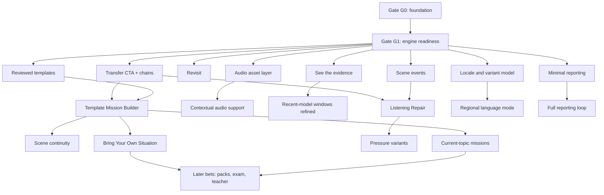

# LearnByRP — Post-runtime product roadmap v2 (reviewed and improved)

**Reviewed:** the pasted roadmap (Phases 0–7, Releases A–E).
**Checked against:** `MISSION_COACH_MASTER_SPEC.md`, `MISSION_COACH_COMPLETE_FEATURES.md`, `UI_UX_2026_AUDIT_AND_PATCH.md`, `LEARNBYRP_CROSS_PLATFORM_UI_SPEC.md`.
**Date:** 30 September 2026

> **Execution checklist:** roleplay/program implementation is tracked in
> `LEARNBYRP_ROLEPLAY_PROGRAM_TODO_V1.md`. This roadmap explains sequencing and policy;
> the TODO is the item-by-item source of execution status.

---

## 0. Basis and limits

- The pasted roadmap says the evidence architecture is "already finished" and that Phase 0 UI work is the only open foundation. **I cannot verify the repository's current state.** Instead of trusting either claim, this version turns the foundation into **testable gates** (§3). If your code already passes them, you lose nothing.
- Items described as "Mural-derived" (`ConversationActivityController`, provider error taxonomy, typed-draft retention, network recovery, audio lifecycle boundaries) are not in the three input documents I read; I treat them as your earlier analysis.
- Numeric values are [Tunable] starting points, never validated facts. Provider capabilities (speech-rate control, regional voices) are [verify].
- Labels: **[Decision]**, **[Proposal]**, **[Tunable]**, **[verify]**, **[Hypothesis]**.

---

## 1. Verdict

**The direction is right and the first wave (transfer, visible evidence, revisit) is the right first wave.** The weaknesses are in sequencing, in a few definitions that would let the system overclaim, and in missing gates.

### 1.1 Keep as written

Core principle (practice opportunities, evidence integrity, support → independent → transfer) · keeping both Retry and Transfer · "different vocabulary is not a different context" · strict, non-shaming revisit framing · Listening Repair as explicit, opt-in, authored · accessible alternative path · audio as part of the evidence system · mission preview and the "no exact template" fallback · carry-forward allowlist · pressure variants not creating context credit · BYOS ephemeral pipeline · exam practice limited to one program, speaking only, no fake scoring · avoiding leaderboards, XP, avatars, mass voices, pronunciation percentages.

### 1.2 Issues and changes

| ID | Issue in the pasted roadmap | Why it matters | Change in v2 |
|---|---|---|---|
| R1 | Phase 0 "done when" is qualitative and omits consent enforcement, endpoint security, regulated-domain content, server-authoritative scene state, and retry forking | Those were the P0 items that can harm users or cost money | **Gate G0** with named tests (§3.1) |
| R2 | Phase 1 says transfer "uses the skill/context engine almost for free" without listing what that engine needs | Transfer is meaningless without a skill catalog, context families, an opportunity rule, and coverage lint | **Gate G1** (§3.2) |
| R3 | `TranscriptAssembler` sits in Phase 2, but Phase 1's evidence view depends on stable passages and revisions | Dependency inversion | Move to **G1** |
| R4 | Revisit trigger starts from `task outcome = not_achieved` | Scene success is not skill evidence: a learner can achieve the goal without the skill, or fail for unrelated reasons | Add a separate **`demonstration`** field; soft/flag two-step policy (§4.2, §4.6) |
| R5 | "Steady + lapse = Steady, reviewDue" with no limit | A permanent Steady label can outlive the evidence | Show **last independent use**; repeated lapses lower the label under a versioned policy (§4.6) |
| R6 | Closing loop states "2 contexts / 2 days → Growing; 4 / 3 → Steady" as facts | These are untested heuristics; a 3-day span can be crammed into one week | Keep as **candidate policy v2 [Tunable]**, retain a minimum span rule, calibrate (§4.5, §8) |
| R7 | "Replay My Evidence" implies audio; explanations are described in prose | Expectation mismatch; model-written explanations can hallucinate | Rename **"See the evidence"**; explanations come from **reason codes** (§4.8) |
| R8 | Transfer chain shows items as "Later" (locked feel); coverage counted per skill only | Locks restrict exploration; 3 contexts may all be too hard for a beginner | **No locks**; suggestions only; coverage per **skill × language × level band** |
| R9 | `audio_replay` / `audio_slow` / `model_phrase` are coarse | Replaying the assistant's question is not the same as hearing the target phrase before saying it | Split by **role** (comprehension vs production model) and add a **supportRelevance** matrix (§4.3) |
| R10 | "Evidence classification adapts" for captions/slow speech is vague | Risk of penalizing accessibility accommodations | Model **accommodations** separately from help; relevance by skill modality (§4.4) |
| R11 | Listening Repair assumes the provider can speak faster on demand | Provider speech-rate control is unverified | Challenge types gated by **capability flags**; repair window rule; excluded from emergency/medical sims |
| R12 | Mission Builder lacks crisis detection, slot sanitization, latency fallback, demand telemetry | Safety, prompt-injection, and a missing product signal | Added (§5.C) |
| R13 | "Mission Memory" can read as AI-companion memory | Trust and creepiness risk | Rename **"Scene continuity"**; visible, editable, expiring, alias not real name |
| R14 | Regional Mode fixed at Phase 4 | If the launch market is Belgium, regional content is a launch need | Placement depends on the **launch-market decision**; variants are not contexts |
| R15 | AI reporting arrives in Phase 6 | Safety reporting should exist before public voice beta | **Minimal reporting in Release A**; full loop later; mask PII, not only secrets |
| R16 | Current-topic missions use "fresh web source → mission" | News topics add neutrality, copyright, and misinformation risk | Curated topic allowlist, original briefs, human review, neutral by default |
| R17 | Reliability work appears both in Phase 0 and Release B | Duplicated and confusing ownership | **Baseline in G0, advanced in B** |
| R18 | Missing: metrics, calibration, content-ops capacity, cost model, reminders, kill criteria, legal review, web/mobile parity | A five-release plan for a solo builder needs decision points | Added (§7–§9) |

---

## 2. Principles

Kept: *do not add more AI features; add features that create better practice opportunities, preserve evidence integrity, and move the learner from support to independent use to transfer.*

Added:

1. **Scene truth ≠ skill truth.** Mission success, skill demonstration, and learner support are three separate records.
2. **Every heuristic is policy-versioned and calibrated.** Windows, thresholds, intervals and lapse rules live in `LearningPolicyVersion`; none is presented as scientific fact.
3. **Accommodations are not penalties.** Captions, slower speech and typed input for accessibility are never framed as failure.
4. **Content capacity gates scope.** A feature that needs N reviewed missions does not start until the pipeline can deliver N.
5. **Raw personal text does not persist by default.** User-supplied situations, pastes, and reports are extracted into slots, previewed, and discarded unless the learner chooses otherwise.
6. **Explanations are generated from codes, not from model prose.** Anything that says "why this counted" is deterministic.

---

## 3. Gates and dependency graph

### 3.1 Gate G0 — Foundation (must pass before any release below)

| Area | Passing condition (testable) |
|---|---|
| Voice and session | Recursion and stale-state regression tests pass; mute/freeze/retry honored by every handler; reconnect, error and mic-denied states visible; provider error taxonomy; typed-draft retention; audio lifecycle closes on every end path (**the reliability baseline**) |
| Evidence | Validator is the only write path (compile-time enforced); forged proposals rejected; phrase drill cannot create unassisted evidence after a reveal |
| Scene runtime | Server holds scene state; forged facts ignored; duplicate `actionId` → one transition; retry forks a new attempt |
| Safety | No dosage/treatment/diagnosis content in any mission or fallback text; regulated-domain policy applied |
| Privacy and security | Tri-state consent enforced **server-side**; AI endpoints require a guest token, rate limits, schemas, server-side mission lookup |
| Persistence | Archive behind `ArchiveRepository`; incremental saves; deletion tombstones; interrupted-session recovery |
| UI | UI audit **Critical** and **High** items closed: 48 targets, contrast checks in CI, live-state announcements, back-gesture handling, large-text-safe layouts, reduced motion, text floor of 12; navigation is Talk / Missions / Progress; Settings reachable |

### 3.2 Gate G1 — Engine readiness (must pass before Release A)

| Area | Passing condition |
|---|---|
| Skill catalog | Skills, domains, scenarios and scenario families exist as **validated data** with a linter; the five heuristic skills are migrated |
| Context identity | `SkillContextKey` uses `scenarioFamilyId`; variants point to a family and never count as new contexts |
| Opportunity rule | A skill can be observed only in a mission that declares it |
| Observations | `SkillObservation` carries `skillId`, `contextKey`, `dayKey`, `demonstration`, support exposure IDs, `policyVersion` |
| Transcript | `TranscriptAssembler` produces passages with `passageId`, `revision`, `textAssemblyVersion`; provider fixtures from real event logs |
| Support model | Exposure kinds and the `supportRelevance` matrix (§4.3) implemented; accommodations modeled |
| Coverage lint | Build reports transfer coverage per skill × language × level band |
| Safety net | Minimal "report a problem with this reply" exists (§5.A) |

### 3.3 Dependency graph



---

## 4. Foundations to add (data and policy deltas)

### 4.1 Context identity and scenario families [Decision]

```ts
type SkillContextKey = {
  domainId: string;
  scenarioFamilyId: string;     // authored and reviewed
  examTaskId?: string;          // exam tasks form their own family type
};
```

**Distinct-context test:** two observations are in different contexts only if their `domainId` differs **or** their `scenarioFamilyId` differs. A scenario family groups missions that share interlocutor role, register, and goal pattern.

| Counts as a new context | Does not count |
|---|---|
| Hotel booking → medical appointment → work meeting | Hotel A → hotel B |
| | Same mission at faster speech (pressure variant) |
| | Regional variant of the same scenario |
| | Same scene retried |

Linter rules: every mission has a family; a family needs a reviewer-written definition; variants must reference a base mission and are excluded from context counting.

### 4.2 Separate scene outcome from skill demonstration [Decision]

```ts
interface SkillObservation {
  observationId: string;
  skillId: SkillId;
  contextKey: SkillContextKey;
  dayKey: string;
  opportunity: { missionId: string; missionVersion: number; eventId?: string };
  taskOutcome: 'achieved' | 'partial' | 'not_achieved' | 'unknown';          // scene truth
  demonstration: 'demonstrated' | 'attempted_not_demonstrated' | 'unknown';  // skill truth
  retrieval: 'assisted' | 'unassisted' | 'unknown';
  modality: 'spoken' | 'typed';
  rehearsal: boolean;
  supportExposureIds: string[];
  reasonCodes: ReasonCode[];
  policyVersion: number;
}
```

A **lapse** is derived from `demonstration = attempted_not_demonstrated` in a cold, relevant-support-free, non-rehearsal opportunity. It is never derived from `taskOutcome` alone.

### 4.3 Support exposure kinds and relevance [Proposal]

New or refined kinds: `intent_hint`, `meaning`, `partial_form`, `full_form`, `model_phrase_audio` (target phrase heard before production), `assistant_audio_replay`, `assistant_audio_slow`, `caption_view`, `typed_example`, `recap_exposure`, `briefing_exposure`.

| Exposure kind | Affects production of the target item? | Affects comprehension-modality skills? | Notes |
|---|---|---|---|
| `intent_hint` | No (recorded) | No | Does not expose the form |
| `partial_form` / `full_form` | **Yes** → assisted for that item within window | No | Scoped to the shown item |
| `model_phrase_audio` | **Yes** → assisted for that item | No | Hearing the target before saying it |
| `meaning` of the assistant's question | No | **Yes** | Comprehension support |
| `assistant_audio_replay` / `assistant_audio_slow` | No | **Yes** | Comprehension support |
| `caption_view` | No | **Yes** (unless an accommodation, §4.4) | |
| Learner copies an assistant phrase within the window | **Yes** → assisted | No | See §4.5 |
| `briefing_exposure` / `recap_exposure` | **Yes** for items shown, within the cross-session window | No | |
| Typed input | Changes modality; spoken evidence not established | n/a | |

"Relevant support" in every rule below means *exposures that this matrix says affect the skill's modality and target item*.

### 4.4 Accessibility accommodations [Decision]

Profile-level settings (captions always on, slower default speech, typed fallback preferred, haptic cues) are `Accommodation` records, **not** per-event help.

- They are recorded and visible to the learner in Settings and in evidence details, with neutral wording ("captions on").
- They do **not** reduce the status of skills outside their relevance (a production skill is unaffected by captions).
- For a future *comprehension* skill, an accommodation can change the evidence label; the UI says so factually, never as failure.
- Listening Repair never concludes "skill failure" because the learner cannot hear well; the alternative path is first-class.

### 4.5 Evidence windows [Tunable]

| Exposure source | Starting window | Basis |
|---|---|---|
| Assistant speech modeled the form | **90 s** | Mural's starting value, per source inspection |
| Coach `full_form` / `model_phrase_audio` | Remainder of the attempt + a short grace [Tunable] | Heuristic |
| Briefing / recap exposure | Same calendar day [Tunable] | Heuristic |
| Copy-match detection | Normalized-text similarity above a versioned threshold | Needs fixtures for ASR variants |

Rules: windows are per item; the whole session is never marked assisted; "on your own" means *no relevant support within policy windows*, not "retrieved from long-term memory"; never use the word "mastered".

Candidate policy v2 for statuses [Tunable, replaces nothing until calibrated]: Growing after independent evidence in ≥ 2 contexts on ≥ 2 days; Steady after ≥ 4 contexts on ≥ 3 days **and** a minimum span between first and last independent use (keep the earlier ≥ 7-day starting rule until data says otherwise).

### 4.6 Lapse and revisit policy [Proposal, Tunable]

| Event | Effect |
|---|---|
| One strict lapse (all conditions below) | **No status change.** Soft recommendation only ("try this skill in another situation") |
| Second strict lapse within a window [Tunable, e.g. 30 days] | "Worth revisiting" flag in Progress; schedule a cold opportunity in a *new* family |
| Repeated lapses after revisit attempts | Label lowers one level under the policy; shown as "last independent use: {date}", never as failure |

Strict lapse conditions: skill opportunity presented (authored event or trigger) · learner produced a relevant attempt · `demonstration = attempted_not_demonstrated` · cold with no relevant support · not rehearsal · valid transcript · **no** silence, noise, disconnect, ASR failure, or language mismatch (those are `unknown`, never lapses). Semantic judgments feed this only after human-calibrated precision is measured (§8).

Always show **last independent use** next to any status so the label cannot outlive its evidence.

### 4.7 TranscriptAssembler [Decision]

```text
provider events → assembler (per-provider adapter) → fragments → passages → revisions → evidence
```

Stores `passageId`, `revision`, `textAssemblyVersion`, origin (ASR / typed / assistant / learner edit), finality. Changing normalization or joining bumps the version; historical evidence keeps its original interpretation. Per-provider adapters carry fixtures recorded from real event logs (event ordering and interruption semantics differ by provider).

### 4.8 Reason codes (for "why this counted")

Examples: `INDEPENDENT_NO_RELEVANT_SUPPORT`, `ASSISTED_MODEL_PHRASE_SHOWN`, `ASSISTED_RECENT_ASSISTANT_MODELING`, `ASSISTED_BRIEFING_EXPOSURE`, `REHEARSAL_NOT_COUNTED_FOR_STATUS`, `TYPED_NOT_SPOKEN_EVIDENCE`, `TRANSCRIPT_UNCERTAIN`, `DISPUTED_BY_LEARNER`. UI strings are localized from codes. No model-written explanation of evidence ever reaches the learner.

---
## 5. Releases

Each release lists scope, specification, content needs, acceptance tests, metrics, risks, and a continue/stop decision. Thresholds for decisions are set **before** release, not after seeing results.

### 5.A Release A — Evidence becomes visible

**Scope:** Transfer CTA with Retry · Transfer chains view · "See the evidence" · Revisit (soft) · minimal AI-reply reporting · transfer-coverage lint.

**Recap actions (three, not two):** *Try this moment again* (forks a new attempt, `rehearsal` when the answer was seen, no new context) · *Practise this skill somewhere else* · *Done*.

**Transfer destination selection [Proposal]**
1. Eligible = content-ready, matches language and level band, outside regulated domains unless consented, from a **different scenario family** than the one just played.
2. Rank by: fewest independent observations for this skill in that family, not recently played, difficulty fit.
3. Offer **2–3 options**, each with a one-line reason ("same skill, different register"). Never auto-start.
4. If nothing is eligible, hide the CTA; never show a dead button.

**Skill chain view (Progress):** per skill, a list of families with *independent / supported / not tried* and one highlighted "suggested next". **No locks:** order is a suggestion, and "Later" is not a state. Name it "Where you've used this skill", not a linear chain.

**See the evidence** (renamed from "Replay My Evidence"; transcript only, no learner audio):

| Section | Content |
|---|---|
| You said | The exact quote and the passage it came from |
| Situation | Mission and family |
| Scene result | Labeled as the *scene's* result, separate from the skill |
| Help before this | Exposures that the relevance matrix says apply, e.g. "No help shown for this phrase before you said it" |
| Why it counted | Localized text from reason codes (§4.8) |
| Last independent use | Date |
| Controls | "That's not right" (creates a dispute and hides from projection), Hide |

Uncertainty is shown, not hidden (for example "transcription uncertain; not counted").

**Revisit (soft):** per §4.6. Surfaces: a Progress card and the existing "Practise due" card on Talk. Reminders are opt-in and carry no streak language. Wording: "worth revisiting", "try this in another situation". Never "lapse", "failed", or "lost".

**Minimal reporting:** "Report a problem with this reply" on an AI turn. Reasons: incorrect, wrong language, unclear explanation, unsafe or inappropriate, other. Show the exact excerpt; require explicit consent per report; **mask PII patterns** (emails, phone numbers, IBAN-like and ID-like strings) with a preview; never attach the full session; send minimal metadata (mission id/version, provider, timestamp), no audio. Rate-limited. This is the backstop for the safety policy, not a substitute for it.

**Content needs [illustrative]:** at least 3 skills × 3 reviewed families × 1 language × 1 level band ≈ 9 missions, plus authored family definitions.

**Acceptance tests**
- A mission in the same family never counts as a new context (hotel A → hotel B).
- A pressure variant or regional variant never counts as a new context.
- Transfer CTA hidden when fewer than 3 reviewed families exist for that skill/language/band.
- Retry creates a new attempt and does not create transfer credit.
- Evidence view shows only exposures relevant to the skill/item; every sentence maps to a reason code.
- A single strict lapse changes no label; a second within the window sets the revisit flag; silence/ASR failure never creates either.
- A disputed observation disappears from projection and is retained for audit.
- Report flow uploads only the excerpt, masked, after consent.

**Metrics:** transfer-CTA tap rate; transfer mission start rate; independent evidence in a second family within a set period; evidence-view open rate; dispute ("That's not right") rate per observation; revisit acceptance; report volume and reasons.

**Risks:** too few contexts at launch; scenario-family definitions drifting; semantic misjudgment of `demonstration`. **Mitigations:** coverage lint, reviewer-written families, calibration (§8).

**Continue/stop:** continue to B if learners start transfer missions and the dispute rate is within the threshold you set; if transfer start is low, test CTA placement and destination clarity before building more content.

### 5.B Release B — Conversation repair and audio

**Scope:** Listening Repair missions · contextual audio support · refined recent-modeling windows. (The reliability *baseline* is already in G0; B adds the advanced parts.)

**Listening Repair [Proposal]**
- A mission *type*, opt-in at briefing with a plain explanation ("the other person may speak fast, use an unfamiliar word, or mishear you"). Off by default for beginners.
- Authored `CommunicationChallenge` events inside the `SceneDefinition`: `faster_speech`, `unknown_word`, `unclear_detail`, `misheard_detail`, `unexpected_followup`; at most one per scene at first [Tunable]; each has a trigger predicate and an optional learner-visible "skip this twist" control with no penalty.
- **Capability flags per provider [verify]:** `speechRateControl`, `scriptedLineInjection`. A challenge type is available only if the flag is true. `misheard_detail` and `unclear_detail` work without speech-rate control.
- **Repair window rule:** an observation is only created if the learner's repair attempt occurs within `repairWindowTurns` after the challenge event [Tunable, start at 2 turns]. The challenge event is the *opportunity*; it proves nothing alone.
- Skills: `communicative_repair`, `check_understanding`, `ask_clarification`, `paraphrase_when_stuck`.
- **Exclusions:** never in emergency or medical simulations; never combined with time pressure for beginners.
- **Accessible path:** captions, typed fallback, repeat, slower speech; none of these produces a "skill failure" verdict (§4.4). Captions are comprehension support and do not downgrade production of the repair phrase.
- **ASR confound:** a missed or garbled repair attempt is `unknown`, not a lapse.

**Contextual audio support [Proposal]**
- Curated phrases: generate once → native-speaker review → cache as versioned assets with provenance (voice, locale, generation date, reviewer).
- Controls: *Listen · Slow · Meaning*. Label the slow version honestly as "slower version".
- Exposure roles: `model_phrase_audio` (target heard before production; affects the item) vs `assistant_audio_replay` / `assistant_audio_slow` (comprehension).
- **Review contexts (phrase drill, "ready to practise"):** record the learner's attempt before audio is offered, or flag audio as support.
- **Audio policy:** playing support audio pauses the live microphone and AI speech; no overlap.
- Reuse the reference-audio authority approach you already designed for SoundSteps rather than building a second one. [your earlier design]
- [verify] Terms of the chosen TTS provider for caching and reuse; availability of regional voices (separate from the live provider's accent).

**Recent-modeling refinement:** item-scoped windows per §4.5, fuzzy-copy detection with fixtures for ASR variants, versioned threshold.

**Acceptance tests**
- Challenge never fires in an emergency/medical scenario or when the capability flag is false.
- Repair attempt outside the window creates no observation.
- Captions-on does not change production evidence of "could you repeat that?"
- Listening to the target phrase before producing it makes that item assisted; listening to the assistant's replay does not.
- Support audio never overlaps live audio.
- Copying the assistant's phrase within 90 s makes only that item assisted; the session is not marked assisted.

**Metrics:** Listening Repair opt-in and completion; skip rate of challenges; repair-skill independent evidence across families; audio replay use; support-audio overlap defects.

**Risks:** provider cannot control speech pace; learners feel tested on hearing. **Mitigations:** capability flags, opt-in, neutral accommodation wording.

### 5.C Release C — Personal practice

**Scope:** template-based Mission Builder · mission preview · scene continuity.

**Builder pipeline [Proposal]**

```text
learner text (typed first)
 → crisis / regulated-domain screening
 → schema-bound extraction (separate call, no tools)
 → deterministic template resolution (allowlisted templates and skills)
 → slot sanitization (length caps, escaping, no free-form instructions)
 → learner preview and confirmation
 → start (reviewed SceneDefinition with slot bindings)
```

- **Crisis and real-risk screening:** if the text describes an actual emergency, abuse, or urgent medical/legal situation, do not create a roleplay; show a plain message that real situations need real help and, for emergencies, local emergency services.
- **Preview** shows role, goal, and focus skills; the learner can edit the goal or cancel.
- **No exact template:** show the closest reviewed practice, never an improvised high-stakes mission.
- **Labels:** "Personalized from a reviewed template" so it is not confused with a fully reviewed mission.
- **Evidence integrity:** completion predicates and skill declarations come from the reviewed template, so observations remain valid; the model can never add a skill ID.
- **Latency:** show progress; fall back to the manual picker if extraction is slow or fails; measure time-to-start.
- **Demand telemetry without raw text:** with consent, store only the structured category (domain, family guess, resolved/unresolved). Unresolved categories drive what to author next.

**Scene continuity (renamed from "Mission Memory")**

```ts
interface CarryForwardFact {
  key: string; value: string;
  sensitivity: 'low' | 'medium';          // high-sensitivity facts are never carried
  source: 'authored_scene' | 'learner_chosen_alias';
  allowedForMission: string[];
  expiresAt: string;
}
```

- Use a **chosen alias**, not the learner's real name, for the character to use.
- Never carry health, financial, or identifying facts.
- Visible "What this place remembers" panel; learner can edit or clear it.
- Local-only by default; server scene state holds scene facts, not personal details.

**Acceptance tests**
- Prompt-injection text inside a request cannot change the system prompt, skill set, or completion predicate.
- A model-proposed unknown skill ID is rejected.
- Unresolved request → closest-practice fallback.
- Slot values exceed no length cap and contain no executable instruction text.
- Regulated-domain requests follow the safety policy; crisis text produces no roleplay.
- A carried fact is readable only when allowlisted and unexpired; clearing it removes it from later scenes.

**Metrics:** template resolution rate; unresolved categories; time-to-start; preview edit rate; completion and transfer rate for personalized missions.

**Continue/stop:** if resolution rate is low, author templates before widening the builder.

### 5.D Release D — Regional depth and advanced difficulty

**Placement rule:** if your launch audience is in Belgium, plan regional content (`fr-BE`, `nl-BE`) from the first content batch and pull this release's content work into A/B. If the launch is broader, keep it here.

**Regional language mode [Proposal]**
- Locale as a content dimension (BCP-47 tags such as `fr-BE`, `nl-BE`) through a `LanguagePack`: preferred vocabulary, regional usage notes, register guidance, scene overrides.
- Native regional review; label regional usage ("Belgian usage", for example number words in Belgian French) and keep standard forms clearly marked; do not teach colloquial regional speech as the standard without a label.
- Do not claim an authentic regional accent. Document separately which voices exist for audio assets and what the **live** provider actually supports. [verify both]
- A regional variant of a scenario is the **same family** (no extra context credit).

**Pressure variants [Proposal]**
- Opt-in, advanced only; `variantKind`: `faster_speech`, `more_concise`, `one_interruption`, `unexpected_followup`, `time_pressure`; each points to a base mission.
- Excluded from context counting; may add a neutral "tried with a twist" attribute that does not change status.
- No on-screen countdown by default; stop control always visible.

**Acceptance tests:** variants never increase the distinct-context count; regional pack never claims accent; voice availability matrix exists per locale.

### 5.E Release E — Intelligent content

**Bring Your Own Situation [Proposal]** (after the Mission Builder is stable and privacy review is done)

```text
paste → ephemeral parse → injection-resistant extraction (fixed slots, no tools)
 → learner preview → confirm → discard raw text → template-based mission
```

- Text only at first (no image/OCR).
- Consent notice before processing; offer a "remove personal information first" hint; show what was extracted.
- Raw text is discarded by default and never written to server logs.
- Special-category content (for example health appointment messages): extract only the practice intent ("reschedule an appointment") and discard details.
- Treat pasted content strictly as data, never as instructions.

**Current-topic missions [Proposal]**
- Start **curated**, not live-generated: an editor-approved topic allowlist with original (not copied) short briefs, visible freshness date, source links, fact vs opinion marked.
- Neutral by default; exclude contested political, violent, tragic, or medical topics; the AI partner does not assert positions on contested issues.
- Practice goals are opinion skills (`give_opinion_with_reason`, `agree_or_disagree_politely`); opinions are not graded as right or wrong.
- Human review before publication until the pipeline proves reliable.

**Full reporting loop:** triage categories, privacy-safe regression cases created from reports, feedback to authors.

**Acceptance tests:** pasted instructions never reach the actor prompt; raw paste absent from storage and logs; briefs cite sources and contain no invented current facts; reported unsafe replies become regression fixtures.

---

## 6. Later bets (conditions before starting)

| Bet | Condition to start | Constraint |
|---|---|---|
| Professional packs | Demand evidence from usage and a simple "which pack next" prompt | Native professional review; no job-outcome claims |
| Exam practice | One program chosen from the launch audience; provenance-verified definitions | Speaking tasks only; "practice", not "simulation"; no score, band, or prediction; original prompts |
| Teacher mission builder | Mature moderation and content model | A separate product surface: sharing, publishing, possible minors' data, permissions |

---

## 7. Cross-cutting requirements

| Area | Requirement |
|---|---|
| **Accessibility** | Every new control meets the UI audit values: 48×48 targets with 8+ gaps, contrast checked in CI, state changes announced, large-text-safe, reduced-motion fallback, text floor 12 |
| **Web/mobile parity** | Learning-relevant behavior (exposure recording, reason codes, transfer eligibility, consent) identical on web and native and tested with shared fixtures |
| **Safety** | Regulated-domain policy applies to builder, BYOS, current-topic, and exam content |
| **Privacy and legal** | Separate consent scopes; raw text not stored; PII masking in reports; **legal review before Releases C and E and before any exam content** (voice and transcript data, AI-disclosure duties, retention, trademarks and exam-body terms); not analyzed here |
| **Content-ops capacity** | Do not start a release whose content need exceeds what your review pipeline can deliver; record reviewer hours per mission and set a weekly throughput target |
| **Cost** | Track cost per completed mission; the builder adds an extraction call, audio caching removes repeated TTS, BYOS adds parsing; budget before enabling |
| **Policy changes** | Every change to windows, thresholds, intervals or lapse rules bumps `LearningPolicyVersion` and rebuilds projections reproducibly |
| **Reminders** | Opt-in only; no streaks; revisit and "ready to practise" only |
| **Localization** | Evidence reason codes, preview text, and consent copy localized; layouts tested at large text |

---

## 8. Metrics, calibration, experiments

**Calibration before automation.** Build a human-reviewed example set across the launch language, accents, noise, and paraphrases. Measure precision of `demonstration` and lapse detection. Enable the revisit flag automatically only after precision meets a threshold you set in advance; until then keep revisit as a soft suggestion.

**Per-release success questions**

| Release | Question |
|---|---|
| A | Do learners start transfer missions, and does independent use appear in a second family? |
| B | Do learners opt into Listening Repair, and do repair skills show independent evidence across families? |
| C | What share of requests resolve to a reviewed template, and what do unresolved categories say about missing content? |
| D | Does regional content change retention or completion for the target audience? |
| E | Do BYOS and current-topic missions get repeat use without safety or privacy incidents? |

**Experiments:** transfer-CTA placement; destination count (2 vs 3); evidence-view entry points; revisit wording; Listening Repair framing. Small samples guide iteration; they do not establish statistical efficacy.

**Privacy-preserving analytics:** event counts and structured categories only; no transcript content.

---

## 9. Risks and open decisions

| Risk | Mitigation |
|---|---|
| Overclaiming from heuristics | Policy versioning, calibration, "last independent use", never "mastered" |
| Too little content for transfer | Coverage lint, content-ops gate, hide CTA |
| Scenario-family drift | Reviewer-written definitions, linter, variants excluded from counting |
| Semantic misjudgment | `unknown` allowed; dispute path; calibration set |
| Provider capability gaps | Capability flags; feature availability per provider |
| Prompt injection via user text | Schema-bound extraction, no tools, slot sanitization, discard raw text |
| Solo-builder overload | Gates, kill/continue decisions after each release, finish A before opening C |
| Legal exposure | Review before C, E, exam |

**Open decisions**
1. Launch market and language (decides where regional depth sits).
2. Production voice provider and its capabilities (speech-rate control, scripted injection, regional voices).
3. First scenario families and the first 3 skills with 3 families each.
4. Policy v2 thresholds (contexts, days, span, lapse window) after calibration.
5. Whether learner-audio replay is ever added (separate consent, storage, retention decision).
6. Which exam program, if any, after usage data.

---

## 10. The core loop after this roadmap (revised)

```text
What do you need to practise?
        ↓
choose a reviewed mission  (or a personalized one from a reviewed template)
        ↓
COLD OPPORTUNITY
no proactive hints · help always reachable and recorded
        ↓
learner speaks
        ↓
scene outcome  +  skill demonstration  +  support exposures   (three separate records)
        ↓
RECAP: exact quotes · exact support · why it counted (reason codes)
        ↓
TRY THIS MOMENT AGAIN        or        PRACTISE THIS SKILL SOMEWHERE ELSE
(new attempt, rehearsal)               (2–3 options, different scenario families)
        ↓
independent use in a new family, on another day
        ↓
status from the versioned policy, always shown with "last independent use"
        ↓
a strict later lapse → soft suggestion; repeated → "worth revisiting"
```

---

## Appendix A — Decision log for the pasted roadmap

| Pasted item | Verdict | Change |
|---|---|---|
| Phase 0 foundation | **Change** | Replace with testable gates G0 and G1 |
| Transfer CTA + keep Retry | **Keep** | Add destination selection, 2–3 options, hide when none |
| Transfer chains | **Change** | No locks; coverage per skill × language × band; rename view |
| Transfer coverage validation | **Keep + extend** | Add language and level-band dimensions |
| Replay My Evidence (transcript) | **Change** | Rename "See the evidence"; reason codes; scene result separated from skill |
| Skill recovery / revisit | **Change** | `demonstration` field; two-step soft policy; last independent use |
| Listening Repair | **Keep + extend** | Capability flags, repair window, exclusions, accommodations |
| Accessible alternative path | **Keep + formalize** | Accommodations model and relevance matrix |
| Contextual audio support | **Change** | Split exposure roles; attempt-before-listen; audio policy; asset provenance |
| Recent-model support | **Keep** | Item-scoped windows, versioned, fixtures |
| TranscriptAssembler | **Move earlier** | Gate G1, before the evidence view |
| Real-Life Mission Builder | **Keep + extend** | Crisis screening, sanitization, telemetry, latency fallback |
| Mission preview / no-template fallback | **Keep** | |
| Mission Memory | **Rename + constrain** | "Scene continuity", alias, expiry, visibility |
| Regional Language Mode | **Keep, move conditionally** | Placement by launch market; variants are not contexts; voices verified |
| Pressure variants | **Keep** | `variantKind`, neutral attribute, no countdown by default |
| Bring Your Own Situation | **Keep, later** | Special-category handling; legal review; text only |
| Current-topic missions | **Change** | Curated first; neutrality; original briefs |
| AI utterance reporting | **Move earlier** | Minimal version in Release A; PII masking |
| Professional packs, exam practice, teacher builder | **Keep as later bets** | Conditions in §6 |
| Release A–E | **Keep, reorder reliability** | Reliability baseline in G0; advanced in B |
| Closing loop thresholds (2/2, 4/3) | **Reframe** | Candidate policy v2, calibrated |
| "Steady never demoted" | **Change** | Repeated-lapse policy with recency display |

*End of roadmap v2.*
