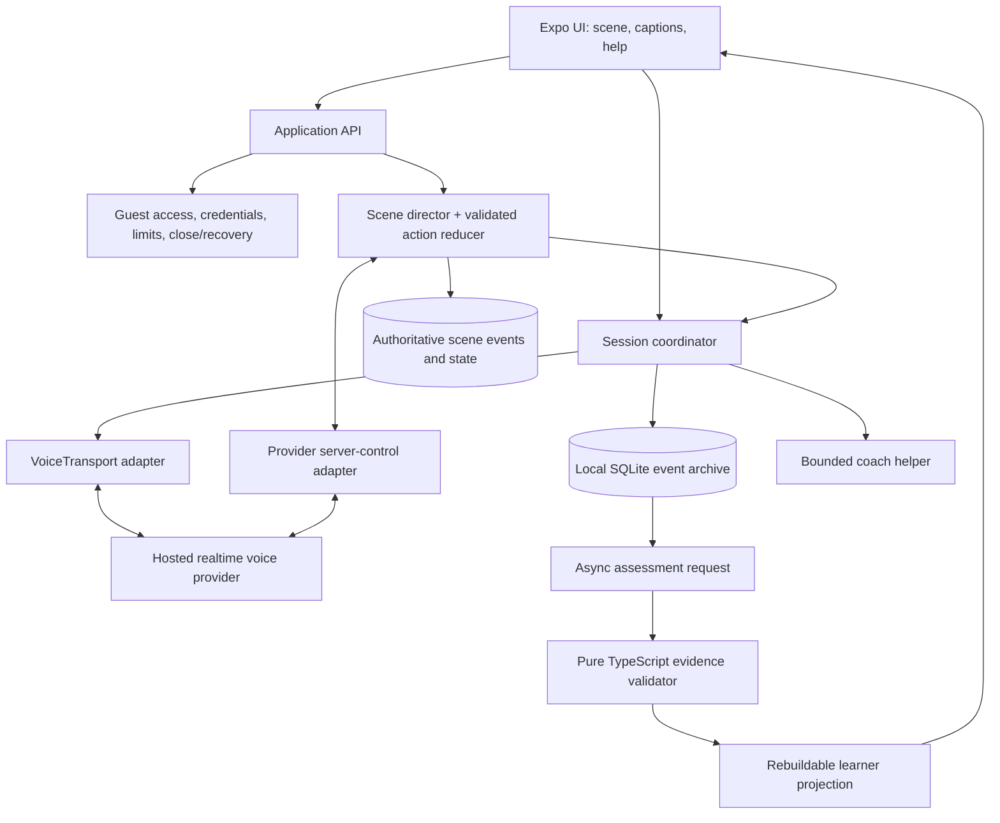
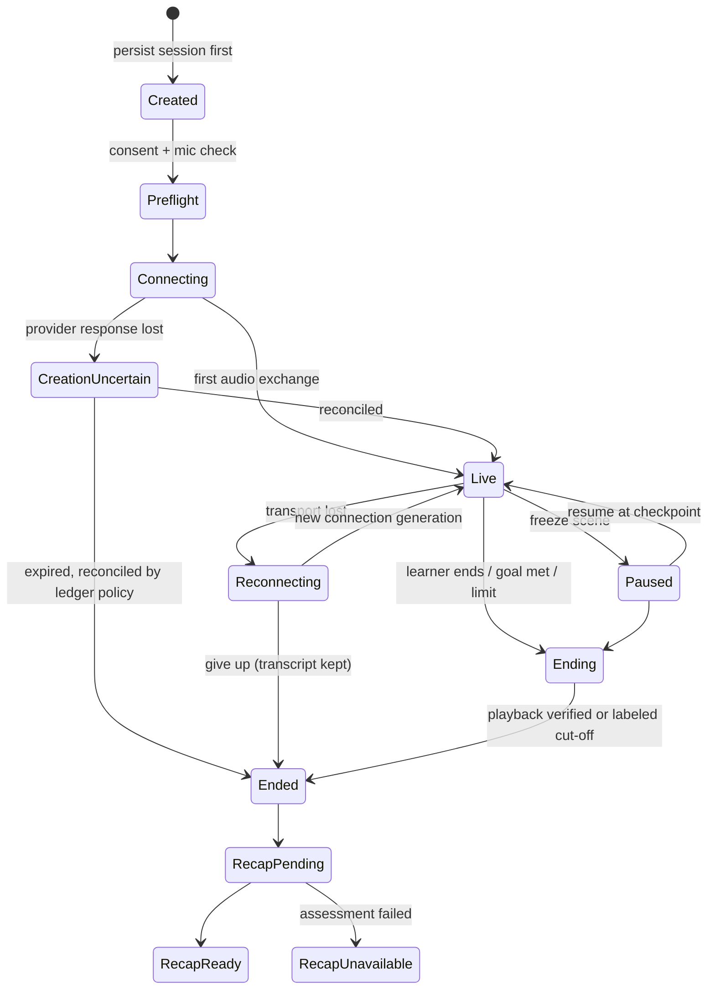

# Mission Coach — Master Product & Architecture Specification

**Consolidation of:** `LANGUAGE_COACH_PRODUCT_BLUEPRINT.md` · `ROLEPLAY_ARCHITECTURE_REVIEW.md` · `VOICE_ARCHITECTURE_RESEARCH.md`
**Source projects synthesized:** Immergo (`ZackAkil/immersive-language-learning-with-live-api`) and Mural (`Chuloo/mural`)
**Date:** 30 September 2026
**Status:** Design proposal. No runtime has been built, no audio path tested, no learning outcome validated.

---

## 0. How to read this document

### 0.1 Evidence labels

Every non-trivial claim carries one of these meanings, stated once here rather than repeated on every line.

| Label                  | Meaning                                                                                                                                          |
| ---------------------- | ------------------------------------------------------------------------------------------------------------------------------------------------ |
| **[Source]**     | Observed in the pinned source files or official documentation, as reported by the three input documents.                                         |
| **[Research]**   | Verified against primary documentation on 2026-09-30 by`VOICE_ARCHITECTURE_RESEARCH.md`. Re-verify at implementation time; provider APIs move. |
| **[Decision]**   | A choice this specification makes. Changing it has architectural consequences.                                                                   |
| **[Proposal]**   | A recommended design that has not been validated.                                                                                                |
| **[Hypothesis]** | A product bet to test with learners. Not a claim of efficacy or uniqueness.                                                                      |
| **[Tunable]**    | A starting value (interval, window, threshold) that is a heuristic, versioned, and expected to change.                                           |

### 0.2 Precedence when the inputs disagree

For current implementation work, `LEARNBYRP_ROLEPLAY_PROGRAM_TODO_V1.md` is the execution-status authority for roleplay/program/pedagogy correctness, while `LEARNBYRP_DESIGN_SYSTEM_V4_TODO.md` is the UI/UX implementation authority. Neither may override the product invariants in this Master Specification.

For the historical source inputs consolidated by this specification:

1. `VOICE_ARCHITECTURE_RESEARCH.md` constrains what transport and provider behavior may be assumed.
2. `ROLEPLAY_ARCHITECTURE_REVIEW.md` supersedes the Blueprint wherever they conflict (list in Appendix C).
3. Blueprint §18 (Expo-first) supersedes Blueprint §9's "separate native clients".
4. Everything else in the Blueprint stands.

### 0.3 Limits of this synthesis

- Repository-level detail (file names, line references, behaviors of Immergo and Mural) comes from the pinned inspections recorded in the three input documents. The repositories were **not re-audited** for this consolidation. Findings about a file are findings about that file, not the whole repository.
- Nothing here asserts latency, price, learning efficacy, or CEFR alignment for this product.
- Package versions are intentionally not pinned. The durable decisions are the boundaries, not the version numbers.

---

## 1. Executive summary

**Mission Coach** is a voice-first language practice app in which an adult learner speaks with one AI character in a concrete real-life situation (a café, a parcel counter, a neighbor), gets help on demand without leaving the scene, and later meets the language they actually needed again, in a different context, until they can use it with less support.

**One-sentence product definition:** *A voice-first mission coach whose next conversation is shaped by the learner's own past conversations; the learner owns the record, and progress is shown only when saved evidence supports it.*

**The core loop**

1. Choose a real situation with one communication goal.
2. Speak naturally with a character who knows only what that character should know.
3. Ask for a hint, meaning, or slower speech, or freeze the scene, without the character turning into a grammar teacher.
4. Review a short recap grounded in quotes from the learner's own speech.
5. Meet selected phrases again in a new situation when due, with an honest record of what support was given before.
6. See progress as observable behavior over time ("used independently in two contexts"), never as an unexplained fluency score.

**Three layers** (each can fail without taking down the others):

| Layer                  | Owns                                                                                 | Authority                                                   |
| ---------------------- | ------------------------------------------------------------------------------------ | ----------------------------------------------------------- |
| **Conversation** | Microphone, speech detection, character audio, interruption, captions                | Provider realtime session + client transport                |
| **Scene**        | What is true in the fiction: facts, character knowledge, permitted actions, outcomes | Server-side director + validated action reducer             |
| **Learning**     | What the learner demonstrably did and with what support                              | Client-side pure TypeScript core over a local SQLite ledger |

**Mobile stack [Decision]:** one Expo React Native app (iOS + Android), Expo Router, TypeScript, EAS custom development builds, `react-native-webrtc` for live voice, `expo-sqlite` for the local archive, one hosted realtime provider first.

---

## 2. Source synthesis: best of both repositories

### 2.1 What each source project is

**Immergo [Source]** — a browser-first, scenario-led experience.

- Front end: a simple flow *splash → missions → chat → summary* (`app-root.js`); a mission screen that asks which languages the user speaks and wants to learn, offers experience modes, then scenario choices (`view-missions.js`).
- Conversation: Gemini Live through a Python FastAPI WebSocket service (`server/main.py`, `server/gemini_live.py`); browser audio capture via an audio worklet.
- Teaching behavior: distinct *immersive* and *teacher* prompts, streaming audio, optional transcripts. Immersive mode holds progress until the learner attempts the target language. Teacher mode asks for gentle corrections, vocabulary, recall checks and scaffolding.
- Completion: a `complete_mission` function call with a 1–3 fluency rating chosen by the model.

**Mural [Source]** — a native, evidence-centered learning product.

- Clients: iOS (Swift) and Android (Kotlin), plus a TypeScript hosted API service.
- Conversation: OpenAI live sessions over WebRTC (`LiveTransport.swift`), an explicit `ConversationCoordinator`, session lifecycle and states.
- Memory: a local archive with data controls (`Storage.swift`), recoverable sessions.
- Learning: `LearningEngine.swift` validates model-proposed word evidence against the transcript and projects word/challenge/capability states from validated observations; a parallel `LearningRepository.kt` on Android.
- Service: hosted API routes and a live-provider adapter separating hosted access, personal provider credentials, live voice, and one-shot helpers.
- UI: Talk / Themes / Words destinations, adaptive theme cards, visible speech state, captions, help and typed fallback.

### 2.2 Adopt / adapt / reject matrix

| Area                           | From Immergo                                                              | From Mural                                                                 | Mission Coach decision                                                         |
| ------------------------------ | ------------------------------------------------------------------------- | -------------------------------------------------------------------------- | ------------------------------------------------------------------------------ |
| **Entry experience**     | Adopt: immediate reason to speak; splash→missions→chat→summary clarity | —                                                                         | Adopt the clarity; drop the desktop-density two-dropdown panel.                |
| **Conversation modes**   | Adopt: immersive vs teacher prompt split                                  | —                                                                         | Adapt to three modes:**Immersion / Guided / Focused practice**.          |
| **Voice transport**      | Reject: browser WebSocket + PCM worklet for mobile                        | Adopt: native WebRTC, explicit connection states                           | WebRTC in an Expo dev build; WebSocket/PCM is a separate later track.          |
| **Session lifecycle**    | —                                                                        | Adopt: coordinator, states, recovery                                       | Adopt and extend (generation IDs, uncertain creation, pause).                  |
| **Mission completion**   | Reject: model-delegated completion and rating                             | —                                                                         | Replace with director-validated action reducer + authored outcome predicates.  |
| **Learner model**        | Reject: a single model-chosen score                                       | Adopt: validated observations → deterministic projection                  | Adopt; split identity (phrase/lexical/skill) and split recall from scheduling. |
| **Evidence validation**  | —                                                                        | Adopt: fragment IDs, quote-in-evidence, revision match, assisted downgrade | Adopt the provenance checks; add exposure ledger; add abstention.              |
| **Persistence**          | —                                                                        | Adopt: local archive, export/delete                                        | Adopt with SQLite transactions, deletion markers.                              |
| **Hosted access**        | —                                                                        | Adopt: separation of hosted / BYOK / live / helper                         | Adopt; bootstrap hosted guest access in the*first* voice slice.              |
| **Cross-platform rules** | —                                                                        | Adopt: shared fixtures                                                     | One TypeScript core; fixtures still shared with backend validators.            |
| **Navigation / UI**      | Adopt: mission-first path, recap                                          | Adopt: short tab set, visible voice state, captions                        | Three tabs (Talk / Missions / Progress) + full-screen session.                 |
| **Dev tooling**          | Reject: developer control center in the consumer app                      | —                                                                         | Keep dev tools out of the product build.                                       |

### 2.3 Defects found in the sources (do not inherit)

| Source                        | Finding [Source]                                                                                                                                         | Consequence for this design                                                                                                            |
| ----------------------------- | -------------------------------------------------------------------------------------------------------------------------------------------------------- | -------------------------------------------------------------------------------------------------------------------------------------- |
| Immergo`view-chat.js`       | Mission completion and a 1–3 fluency rating are delegated to the model's tool call; no evidence validator or deterministic evaluator in this component. | Outcome is decided by authored predicates applied by the reducer; the model may only*propose* an action.                             |
| Immergo`view-chat.js`       | Teacher mode requests score 0, yet the result mapping defaults unknown scores to`Proficiens`.                                                          | Unknown stays**unknown**. No default that flatters the learner.                                                                  |
| Immergo`view-chat.js`       | Completion cleanup waits a fixed 2.5 s then disconnects and interrupts audio, which does not prove the closing speech finished.                          | Shutdown waits for verified playback completion or an explicit, labeled cut-off.                                                       |
| Mural`LearningEngine.swift` | Confidence 0.8–1 is a check on model output, not calibration.                                                                                           | Confidence is never displayed as learner ability and never drives progress alone.                                                      |
| Mural`LearningEngine.swift` | Typed fragments are treated as assisted; modeled-form window is 90 s.                                                                                    | Keep as**[Tunable]** starting rules, but distinguish typed written retrieval from copying, and account for pre-session exposure. |
| Mural`LearningEngine.swift` | Fixed small due-interval heuristic; not a validated CEFR test or calibrated spaced-repetition model.                                                     | Versioned scheduling policy; never claim optimal spacing.                                                                              |
| Mural (general)               | A valid quote + valid JSON proves provenance, not correct interpretation.                                                                                | Provenance validation and semantic judgment are separated; "unknown outcome" is legal.                                                 |

### 2.4 What neither source provides

Neither project defines a **roleplay runtime**: who knows what, which facts can change, when a complication is allowed, what counts as an outcome. Without it, a live model defaults to an agreeable tutor conducting an interview. Adding that subsystem (Section 6 and 11) is the principal new contribution of this specification.

---

## 3. Product philosophy

Merged from Blueprint §2 and the roleplay review. Each principle has an engineering consequence.

| #  | Principle                                                                                                            | Engineering consequence                                                                                                   |
| -- | -------------------------------------------------------------------------------------------------------------------- | ------------------------------------------------------------------------------------------------------------------------- |
| 1  | **Conversation is the lesson.** Most session time is the learner trying to communicate.                        | Ordinary banter never awaits an assessor. Missions are flexible contexts, not scripts.                                    |
| 2  | **Progress must be explainable.** Every saved item traces to a passage in a conversation.                      | Observations carry source turn IDs, revision keys, and support exposure IDs.                                              |
| 3  | **The model proposes; the product validates.**                                                                 | Model output (actions, observations, goals) passes schema, provenance, revision, and policy checks before touching state. |
| 4  | **Scene truth and learning truth are different.** A request can succeed in the fiction without proving skill.  | Two ledgers: scene events (server-authoritative) and learning observations (client-validated).                            |
| 5  | **Help preserves agency.** The learner chooses hints, translation, slowing, pausing, ending.                   | Help is a separate surface; every support event is recorded and shown honestly.                                           |
| 6  | **Support is scoped to the skill observed.**                                                                   | A translation of a question supports comprehension, not production of the answer.                                         |
| 7  | **Abstain when uncertain.** Silence, noise, disconnects, failed assessment, ambiguous playback are not lapses. | `unknown` is a first-class value in outcome and retrieval.                                                              |
| 8  | **Memory belongs to the learner.**                                                                             | On-device archive, consent per scope, export, correction, deletion as core flows.                                         |
| 9  | **Reliability is part of the teaching experience.**                                                            | Every connection/permission/time-limit state has a visible recovery action.                                               |
| 10 | **Reuse beats volume.** The same pattern in a new context teaches more than many unrelated scenarios.          | Content is planned for transfer (café substitution → parcel reschedule → neighbor meeting place).                      |
| 11 | **No claims beyond evidence.** No fluency certification, no CEFR rating, no streak theatre.                    | UI copy and metrics constrained accordingly (Sections 7.8, 19).                                                           |

---

## 4. Audience, job, promise, differentiation

**Initial audience [Decision]:** adults learning a language for travel, relocation, social life or everyday independence; beginner to lower-intermediate; they know some vocabulary but lack confidence speaking spontaneously.

**Job to be done:** *"Help me practise the situations I will face, let me recover when I get stuck, and help me remember the language I actually needed."*

**Promise:** *Practise the conversations you need in real life. Keep the phrases you learn. Meet them again until you can use them on your own.*

### 4.1 Competitive reality [Source: roleplay review]

- Speak documents voice roleplay with themed characters and settings, on-demand support, interruptions and retry.
- Duolingo documents structured calls, character personality, remembered user facts, and checks allowing learner-led topic changes.

Therefore **characters, scene art and conversation memory alone are not differentiation.**

### 4.2 Proposed differentiation [Hypothesis]

The *combination* of: persistent scene consequences, bounded character knowledge, deliberate opportunities to repair misunderstandings, and later reuse with an honest record of support received. The unit of progress is **a phrase or communicative ability used with decreasing support across relevant contexts**, not lessons completed or minutes spent. Validate whether learners value this before expanding content.

---

## 5. Scope

### 5.1 First vertical slice [Decision]

One launch language · one interface language · one hosted provider · one café scene · one curated variation · one linked second context · hosted guest bootstrap · local archive · voice interruption · help exposure recording · recap · one scheduled cold revisit. A static menu prop; no animated characters.

### 5.2 Release 1 — prove the learning loop

- Expo app, native voice on iOS and Android dev builds.
- Small curated connected-episode library.
- Live conversation with captions, on-demand support, freeze scene, retry from a moment.
- Local SQLite archive with interrupted-session recovery.
- Transcript-grounded recap with evidence labels and learner controls (Save / Edit / Hide / "That's not right").
- Phrase/skill states with separate recall and scheduling dimensions.
- Consent, history, on-device export, single-session and full deletion.
- Minimal hosted bootstrap: guest access, credentials, session limits, close/recovery.

### 5.3 Release 2 — make learning continuous

Adaptive mission recommendations · review inside new contexts · more languages and level bands · account and optional encrypted sync · usage limits and entitlements · content-operations tooling and mission version management · curated variations (role reversal).

### 5.4 Later possibilities

Additional speech providers behind the adapter · teacher/family/classroom views with explicit sharing · themed packs and interests · "explain for someone else" mediation tasks · "rehearse tomorrow" user-filled reviewed templates · purchase flows if validated by usage.

### 5.5 Explicit non-goals for the first release

Full curriculum for every level · social features, leaderboards, public profiles · unreviewed user-authored AI lessons · claims of CEFR certification or fluency · points economy · provider picker in the main flow · multi-character simultaneous voice agents · runtime-generated video or a large simulated city · commercial billing features (defer; keep only guest access, limits, close/recovery).

---

## 6. Experience design: connected episodes

### 6.1 Concept [Hypothesis]

*Practise a life in another language, with help available when needed, and revisit situations with increasing independence.* A small fictional neighborhood gives decisions consequences across scenes: the learner visits a café, collects a parcel, asks a neighbor for help. Reuse characters and **authored** fictional facts selectively; never infer private personal details from casual speech.

### 6.2 Anatomy of an episode

Each episode requires:

1. A practical reason to speak.
2. Information the learner has and information the character has (an **information gap**).
3. A choice or constraint that can change the result.
4. One communication objective and **at most one** initial complication.
5. A visible consequence and a natural stopping point.

**Worked example — breakfast before a train.** The menu is visible; the character knows one item is unavailable. The learner must discover an alternative and confirm the takeaway order.

- A grammatically imperfect but clear request **can succeed**.
- A perfect sentence asking for the wrong item **does not** complete the task.

### 6.3 Rules for complications

- A complication follows from authored scene facts or a clearly labeled practice variation. **Never manufacture confusion only to force a target phrase.**
- Allow clarification, paraphrase, topic detours, and changed goals. The character guides back with a natural question, not abrupt termination.
- Beginners get think time. Time pressure is optional and independent of language complexity.
- If the learner thinks for a long time, do not keep generating questions to fill silence.

### 6.4 Transfer by communication pattern

The next episode reuses a **pattern**, not an identical sentence:

| Episode        | Pattern exercised                 |
| -------------- | --------------------------------- |
| Café          | Request a substitution            |
| Parcel counter | Request a different delivery time |
| Neighbor       | Propose a different meeting place |

### 6.5 Ideas to test, and delivery priority

| Idea                          | Learner experience                                | Learning purpose                                 | Priority                                               |
| ----------------------------- | ------------------------------------------------- | ------------------------------------------------ | ------------------------------------------------------ |
| Connected neighborhood        | A decision has a consequence in a later scene     | Makes transfer meaningful                        | First differentiating slice; few facts, few characters |
| **Freeze the scene**    | Pause, ask a private coach for a strategy, resume | Support without the character becoming a teacher | Release 1                                              |
| **Retry from a moment** | Return to a checkpoint, try a different response  | Makes conversational repair concrete             | Release 1, labeled assisted/rehearsed                  |
| Information-gap task          | Character and learner hold parts of the solution  | Gives questions a real purpose                   | Release 1, static props                                |
| Reverse the roles             | Learner is the café worker or guide              | Flexible use of familiar language                | After first slice; curated                             |
| Explain for someone else      | Relay a simple instruction to a visitor           | Mediation                                        | Later, reviewed content                                |
| Rehearse tomorrow             | Learner picks a real upcoming situation           | Personal relevance                               | Later; user input fills a reviewed template            |

Clarification, turn-taking, goal-oriented interaction and mediation are recognized communicative dimensions in the CEFR Companion Volume. That supports breadth of task coverage; it is **not** an efficacy claim and **not** a CEFR rating.

### 6.6 Conversation modes

| Mode                       | Behavior                                                                                    | Inspired by              |
| -------------------------- | ------------------------------------------------------------------------------------------- | ------------------------ |
| **Immersion**        | Target language only; progress waits for an attempt; help available on request only         | Immergo immersive prompt |
| **Guided**           | Gentle corrections, vocabulary, scaffolding, recall checks; hints after repeated difficulty | Immergo teacher prompt   |
| **Focused practice** | Short conversation built around due phrases/skills in a new context                         | Mural review loop        |

### 6.7 Runtime roles (responsibilities, not necessarily separate model processes)

| Role               | Does                                                                                                                                                                                                                                                                      | Must not                                                          |
| ------------------ | ------------------------------------------------------------------------------------------------------------------------------------------------------------------------------------------------------------------------------------------------------------------------- | ----------------------------------------------------------------- |
| **Actor**    | Speaks as the current character using committed scene facts and*only that character's* knowledge; may *propose* a scene action                                                                                                                                        | Declare canonical success, award progress, edit entitlement state |
| **Director** | Chooses an authored complication, validates proposed actions, updates scene state, controls pacing, supplies a compact snapshot. Mostly application code + authored rules; bounded model interpretation only where natural language requires it, with uncertainty allowed | Let actor speech override a rejected action                       |
| **Coach**    | Learner-requested hints/explanations in a clearly separate text surface. Ladder: intent hint → partial construction → full wording. Every support event recorded                                                                                                        | Speak over the character initially (no competing voices)          |
| **Observer** | Asynchronously proposes evidence-linked observations                                                                                                                                                                                                                      | Write learner state; the deterministic core does that             |

**Least-context rule:** never give the actor the full archive, the coach conversation, future complications and the assessment rubric in one giant prompt.

**One active character** at a time; sequential scene changes only. No simultaneous multi-agent voices in the initial product.

---

## 7. Information architecture and pages

### 7.1 Navigation model [Decision]

```text
Bottom tabs (hidden during a session)
  Talk        Home: continue, due practice, suggested mission
  Missions    Search, categories, mission cards
  Progress    Due phrases, phrase/skill states, history

Stack / modal routes
  /onboarding                 First-run setup (once)
  /mission/[missionId]        Mission briefing
  /session/[sessionId]        Full-screen live conversation
  /recap/[sessionId]          Learning receipt
  /phrase/[phraseId]          Phrase detail + transcript evidence
  /settings                   Preferences, account
  /settings/privacy           Consent, retention, export, deletion
```

Returning from recap lands on the previous tab. Account, usage and purchase screens stay out of primary navigation until hosted access is user-visible.

### 7.2 Welcome and language setup (`/onboarding`)

Collect only what improves the first session:

- Language to practise · language for explanations.
- Approximate comfort level, with **"not sure"**.
- Primary goal: travel, relocation, work, social, explore.
- Consent for live voice processing, and (separately) for saved conversation analysis.

All changeable later. **No long placement test** before the first conversation. Include a short plain-language explanation of microphone use and that live audio is processed by an AI provider.

### 7.3 Talk (home)

Must answer *"What can I do now?"* immediately.

- Greeting naming the learning language and current mode.
- One large **Continue conversation** card if a session/episode is available.
- Smaller **Practise phrases due** card with an honest estimate ("about 3 minutes").
- One personalized mission suggestion **with its reason** ("reuses two phrases from your café practice").
- A calm "Choose a mission" link.

No chart, streak counter, or mission grid above the primary action.

### 7.4 Missions

- Search field; horizontally scrollable intent/category chips; filters for duration, support level, theme.
- One featured mission with setting illustration and goal; vertical list of compact cards grouped by situation.
- Card shows setting, intent, duration, support style. One restrained icon/illustration per category (emoji never the only visual language). No grade promised.
- Categories: food & cafés · shopping & services · transport & directions · accommodation · meeting people · appointments & practical problems.
- Language selection lives in onboarding/settings, not as the visual centerpiece.

### 7.5 Mission briefing (`/mission/[missionId]`)

- Scene title, one short setting description, character role.
- Primary goal, optional stretch goal, duration.
- Mode selector: **Immersion / Guided / Focused practice**, each explained in plain language.
- If phrases are reused: at most two, marked as *practice suggestions, not a script*.
- **Cold attempt option [Proposal]:** start without revealing target wording. Briefing exposure is always recorded; if the learner reveals phrases here, later use is assisted.
- Audio-permission explanation; one sticky primary action: **Start conversation**.

### 7.6 Live session (`/session/[sessionId]`)

**Layout (top → bottom):** scene label + compact goal · latest target-language caption with optional meaning line beneath · voice-activity visualization (secondary; must not displace caption readability) · controls: **mute · Help · typed fallback · end**.

**Visible states:** `connecting · listening · speaking · muted · paused (scene frozen) · reconnecting · ending`, plus **microphone-denied** and **connection-failed**. Every state has a recovery action; no indefinite spinner.

**Help action sheet:**

- *Give me a hint* (ladder: intent → partial → full)
- *Help me say that*
- *Explain that / What did that mean?*
- *Say it more slowly*

**Freeze the scene:** stops/cancels actor output, suspends scene advancement, opens the private coach text overlay, records exposure, resumes at the committed checkpoint. No new character questions while frozen.

**Retry from a moment:** fork from a scene checkpoint into a new attempt ID. Original evidence preserved; new attempt marked *rehearsed* if the learner has already seen the answer.

**Captions:** reviewable without taking over the screen; tap a phrase to replay or reveal meaning. Captions distinguish *what the learner said* (recognized text) from *suggested* phrasing.

**Do not:** make an animated orb the only content; hide the tab bar's absence without a clear End control; let typed input silently count as spoken.

### 7.7 Recap (`/recap/[sessionId]`) — "learning receipt"

- One-sentence neutral summary of the task; outcome: **completed / partly completed / changed direction / unknown**. No proficiency judgment.
- 2–5 phrase cards, each with: original transcript quote, suggested form and meaning, **evidence tag** (*heard · used with help · used independently*), and what support preceded it.
- At most one or two actionable corrections.
- Per item: **Save · Edit · Hide · "That's not right"** (and delete).
- One next-mission suggestion with explanation of which phrases it reuses.
- Honest states: *assessment pending* and *assessment unavailable* (conversation preserved, nothing fabricated).
- **Done** returns to the previous tab.

### 7.8 Progress

- **Ready to practise** first.
- Phrase cards sorted by next due date with status label and one-line explanation.
- Ability summaries only after repeated evidence; no ungrounded levels.
- Session history below; each opens transcript and recap.
- Preferred language: *"used with help twice"*, *"used on your own in two situations"* — never a single fluency number.

### 7.9 Phrase detail (`/phrase/[phraseId]`)

Form, meaning, usage note; timeline of observations with quotes; support that preceded each; contexts/days; scheduling status; controls to hide, defer, or dispute an observation; link into the source transcript (`TranscriptSourceSheet`).

### 7.10 Settings and privacy

Language and explanation language · mode defaults and correction preference · AI-processing consent and scope (voice vs saved-history analysis, separate) · transcript and assessment retention · **on-device export** · delete one session / delete all learning data · account and usage info (when hosted features are user-visible) · consent version and withdrawal.

Copy must disclose: live audio is processed by an AI provider; whether transcripts are stored locally, sent for assessment, synced or retained by the service; that files already shared externally cannot be recalled by clearing the app's export cache.

### 7.11 Empty, error and edge states (first-class)

| Situation                     | UX requirement                                                      |
| ----------------------------- | ------------------------------------------------------------------- |
| Mic permission denied         | Explain, offer typed fallback and settings deep link                |
| Connection failed / timed out | Retry + "save and exit"; transcript preserved                       |
| Reconnecting                  | Visible state; no duplicated evidence or usage on rejoin            |
| Session limit reached         | Clear end with recap, not a dead drop                               |
| Assessment failed             | Recap shows "unavailable"; retry later; nothing invented            |
| Interrupted by app kill       | Recover session on next launch; offer recap or discard              |
| Offline                       | Saved history fully usable; live roleplay unavailable, said plainly |
| Deleted during assessment     | Late result discarded (deletion marker)                             |

---

## 8. Visual and interaction design system

### 8.1 Direction

Warm, calm, editorial, adult. Warm paper canvas, dark ink text, muted secondary text, **one** vivid terracotta/orange accent for primary actions and active voice state; a second light accent identifies target-language phrases. Status is never color-only (icon + label). Restrained motion; respects reduced-motion.

### 8.2 Layout principles

One primary action per screen · real-world task before explanatory copy · stable conversation layout while audio is active · generous touch targets and readable captions · scannable recap cards with on-demand transcript evidence · badges only when they represent a meaningful observable behavior.

### 8.3 Tone

Warm, adult, concise, specific. Praise effort and useful strategies, not unsupported ability. Describe errors as chances to make meaning clearer. **Never imply failure because the learner asked for help.** Always distinguish a *suggested phrase* from a *quote the learner actually said*.

### 8.4 Tokens (define before polishing screens)

```text
color.canvas / surface / ink / secondary / accent / targetLanguage / success / warning
space.1..space.8          4pt-based scale
radius.card 20–26pt       radius.pill capsule
type.display / title / body / caption   (supports dynamic type)
motion.short / standard   (reduced-motion aware)
```

### 8.5 Component inventory

| Group        | Components                                                                                                                                                                                             |
| ------------ | ------------------------------------------------------------------------------------------------------------------------------------------------------------------------------------------------------ |
| Mission      | `MissionCard`, `GoalPill`, `ModeSelector`, `DuePhraseCard`                                                                                                                                     |
| Conversation | `ConversationStatus`, `CaptionBlock`, `MeaningLine`, `VoiceActivity`, `ConversationControls`, `HelpActionSheet`, `FreezeOverlay`, `MicrophonePermissionCard`, `RetryCheckpointSheet` |
| Learning     | `EvidencePhraseCard`, `EvidenceTag`, `TranscriptSourceSheet`, `SupportTimeline`                                                                                                                |
| System       | `EmptyState`, `RecoverableError`, `ConsentSummary`                                                                                                                                               |

### 8.6 Accessibility [Decision]

Screen-reader labels, roles, selection state; dynamic type; reduced motion; contrast-safe status colors; captions always available; typed fallback path; controls reachable one-handed. Accessibility is built in from the first screen, not added after.

### 8.7 UI to borrow vs avoid

| Borrow                                                                                                           | Avoid                                                                        |
| ---------------------------------------------------------------------------------------------------------------- | ---------------------------------------------------------------------------- |
| Immergo: immediate mission path (choose → talk → recap)                                                        | Immergo: dense language/mode panel, developer control center                 |
| Mural: short tab set, visible voice state, captions + help/typed input on the same surface, adaptive theme cards | An orb as the only conversation content; dashboards above the primary action |

---

## 9. Content model

Content is **authored, versioned, reviewed**. The AI receives objectives and policy, not a rigid script. Versions are immutable once released so old evidence stays interpretable.

### 9.1 Records

**MissionDefinition** (blueprint §7, retained)
`id`, `version`, `language`, `levelRange`, `title`, `setting`, `aiRole`, character style, `learnerGoal`, optional `stretchGoal`, `targetIntents`, `usefulPhrases` (form, meaning, usage note, difficulty), `branches`, `supportPolicy` (hint frequency, translation behavior, correction style), `completionSignals`, `safetyNotes` + content review status, `estimatedMinutes`, tags.

**SceneDefinition** (new, roleplay review) — the roleplay runtime contract:
initial facts · permitted mutations · character knowledge (per character) · transition predicates · completion predicates · complication limits · checkpoint policy · allowlisted actions with payload schemas · links to phrase/skill IDs (curated).

**CharacterDefinition** (new) — name/role, voice style, knowledge boundary, what the character may and may not know about prior scenes, pacing (short turns, one follow-up at a time).

**World facts** (new) — the connected neighborhood's small set of established fictional facts that later scenes may reference (Section 9.4).

### 9.2 SceneDefinition sketch [Proposal]

```ts
type SceneDefinition = {
  id: string; version: number; missionId: string; language: string;
  characters: CharacterDefinition[];
  initialFacts: Record<string, unknown>;       // e.g. menu, stock, train time
  learnerKnows: string[];                      // information the learner has
  characterKnows: Record<string, string[]>;    // information each character has
  allowedActions: {
    name: string;                              // e.g. "confirm_order_item"
    actor: 'character' | 'director';           // who may propose/trigger
    payloadSchema: JsonSchema;
    preconditions: Predicate[];                // must hold before applying
    effects: Mutation[];                       // permitted fact changes
  }[];
  complication?: { id: string; trigger: Predicate; maxPerScene: 1; practiceVariation?: boolean };
  completion: { achieved: Predicate; partial?: Predicate };
  checkpoints: { id: string; after: Predicate }[];
  phraseIds: string[]; skillIds: string[];     // curated mappings only
  reviewStatus: 'draft' | 'reviewed' | 'released';
};
```

### 9.3 Sample scene — breakfast café (Spanish example)

| Field                   | Value                                                                                                                            |
| ----------------------- | -------------------------------------------------------------------------------------------------------------------------------- |
| Setting / role          | Neighborhood café, busy morning; friendly café worker                                                                          |
| Learner goal            | Order a drink and ask one question about the food                                                                                |
| Stretch                 | Ask for a substitution or whether an item contains an ingredient                                                                 |
| Learner knows           | Menu (static prop), a train departs soon                                                                                         |
| Character knows         | One item is unavailable; oat milk is available                                                                                   |
| Complication (≤1)      | Requested item unavailable (authored fact)                                                                                       |
| Allowed actions         | `confirm_order_item`, `offer_alternative` (director), `confirm_takeaway`, `complete_scene`                               |
| Achieved predicate      | An available item is confirmed**and** takeaway/for-here is confirmed                                                       |
| Variations              | Takeaway vs here; worker asks a follow-up                                                                                        |
| Useful phrase (example) | `¿Tiene leche de avena?` — equivalent learner phrasing must be accepted; no exact sentence required                          |
| Teaching behavior       | Simple natural language; wait for the learner; hint after repeated difficulty; brief correction only when it helps communication |

### 9.4 Connected neighborhood — world bible [Proposal]

Start tiny: **three locations** (café, parcel counter, neighbor's door) and **three characters**. Persist only authored, scene-generated facts (e.g. "order was substituted", "parcel rescheduled to Thursday"). Scene consequences live in server scene events; the learner's language evidence lives in the local archive. Do not upload the full archive to maintain a fictional order state.

### 9.5 Content coverage map

| Dimension          | Examples                                                               |
| ------------------ | ---------------------------------------------------------------------- |
| Situation          | Café, pharmacy, transit, lodging, meeting someone                     |
| Intent             | Request, clarify, describe a problem, respond, follow up               |
| Support            | Immersion, guided hints, phrase-focused practice                       |
| Difficulty         | Short predictable exchange → open multi-step task                     |
| Personal relevance | Travel, hobbies, work, food, local routines                            |
| Pattern transfer   | Substitution · reschedule · propose alternative · clarify · repair |

### 9.6 Content operations

Authoring → native-speaker/pedagogical review → safety review → simulated/recorded test conversations → release as immutable version. Mission versions remain reproducible. Release gates include reviewed paraphrase examples across accents and noise conditions for the launch language. Changes create a new version; old evidence keeps pointing to the version it was gathered under.

---

## 10. Learning and assessment design

### 10.1 Separate identities [Decision]

| Concept                      | Identity                     | Example                     | Note                                                 |
| ---------------------------- | ---------------------------- | --------------------------- | ---------------------------------------------------- |
| **PhraseItem**         | Curated exact form + meaning | `¿Tiene leche de avena?` | Reviewable and schedulable                           |
| **LexicalItem**        | Lemma / word                 | `tener`                   | Cannot identify every request using that verb        |
| **CommunicativeSkill** | Curated ability              | `request_substitution`    | Observed across contexts; equivalent wording allowed |

Model-generated IDs are **not authoritative**. Stable phrase and skill IDs come from curated mappings; unmapped model proposals are stored as candidates for learner review and excluded from scheduling until mapped or accepted.

### 10.2 Evidence categories

| Category                           | Meaning                                                                                          |
| ---------------------------------- | ------------------------------------------------------------------------------------------------ |
| **Encountered**              | Phrase appeared in learner or assistant speech                                                   |
| **Assisted**                 | Used after a hint, visible meaning, copied typed support, recent modeling, or full-form exposure |
| **Independent (unassisted)** | Used/recalled without recent modeling or visible support for that skill                          |
| **Lapse**                    | Learner attempted it in a cold opportunity but could not retrieve or use it                      |
| **Corrected**                | Original and corrected forms both retained with provenance                                       |

Never collapse these into one "learned" flag.

### 10.3 Exposure ledger [Decision]

Support is recorded **from briefing through recap**, including full wording shown outside the call.

```ts
type SupportExposure = {
  id: string; sessionId: string; attemptId: string; turnId?: string;
  source: 'briefing' | 'actor' | 'coach' | 'caption' | 'retry';
  kind: 'intent_hint' | 'meaning' | 'partial_form' | 'full_form' | 'repeat';
  targetItemIds: string[];
  exposure: 'visible' | 'played' | 'partial' | 'uncertain';
  recordedAt: string;
};
```

Assistant content is tracked as **generated / delivered / interrupted / uncertain**, separately. Transcript timing alone does not prove how much audio the learner heard.

### 10.4 Classification rules (decision table) [Proposal; windows are Tunable]

| Situation                                                                          | Classification                                                                                   |
| ---------------------------------------------------------------------------------- | ------------------------------------------------------------------------------------------------ |
| Learner uses item spontaneously, no prior exposure to it                           | Spoken · unassisted (subject to validation)                                                     |
| Wording shown in briefing, then used                                               | Assisted (briefing exposure). A**cold attempt** avoids this                                |
| Assistant modeled the form within the window (Mural starting value:**90 s**) | Assisted                                                                                         |
| Coach shows`partial_form` / `full_form`                                        | Assisted for that item                                                                           |
| Coach gives only an`intent_hint`                                                 | Recorded; does not expose the form, so it does not by itself downgrade form retrieval            |
| Translation of the assistant's*question*                                         | Comprehension support; does**not** downgrade production of the answer                      |
| Learner spontaneously types an answer                                              | `modality: typed`, written retrieval; **not** evidence of spoken production              |
| Learner types text copied from visible support                                     | Assisted                                                                                         |
| Asking the character to repeat                                                     | Useful clarification strategy; may exhibit a skill without exposing the answer                   |
| Retry in same session after seeing the answer                                      | `rehearsal: true`                                                                              |
| Silence, background noise, disconnect, assessment unavailable                      | No retrieval lapse;`unknown`                                                                   |
| Assistant audio interrupted / playback uncertain                                   | Exposure`partial`/`uncertain`; abstain from independence claims when it matters              |
| Learner edits a transcript                                                         | Distinct source from recognized text; cannot establish what was spoken or diagnose pronunciation |
| Exact phrase not used but meaning communicated                                     | Not a failure; ambiguous equivalence → reviewed/model interpretation with`unknown` allowed    |

### 10.5 Observation record

```ts
type LearningObservation = {
  observationId: string; attemptId: string;
  sourceTurnId: string; sourceRevision: string;
  itemId: string;
  modality: 'spoken' | 'typed';
  retrieval: 'assisted' | 'unassisted' | 'unknown';
  taskOutcome: 'achieved' | 'partial' | 'not_achieved' | 'unknown';
  rehearsal: boolean;
  supportExposureIds: string[];
};
```

### 10.6 Learner states: recall and scheduling are separate dimensions

**recallStatus** (what evidence shows):

| State     | Meaning                                                                                                                                                                                |
| --------- | -------------------------------------------------------------------------------------------------------------------------------------------------------------------------------------- |
| New       | Encountered, no independent evidence                                                                                                                                                   |
| Supported | Used with help or modeled recently                                                                                                                                                     |
| Growing   | Independently recalled at least once                                                                                                                                                   |
| Steady    | Independently recalled across multiple days**and** contexts; the strongest state also requires a span between first and last independent recall (Mural starting rule: ≥ 7 days) |

**Scheduling** (when to meet it again): `nextReviewAt`, `lastLapseAt`, modality history, context history. **"Due" is derived** (`nextReviewAt ≤ now` or a later lapse), *not* a recall state, because an independently used phrase can still be due.

**Skills (communicative abilities)** require several distinct day/context evidence keys (Mural starting rule: **3**) before being shown.

**Intervals [Tunable]:** configurable starting values such as 1, 4, 14 days with lapse and overdue adjustments. These are product heuristics, **not** guaranteed-optimal spacing and not a calibrated spaced-repetition model. Scheduling rules carry a version so rebuilds are reproducible.

### 10.7 Validation pipeline

1. Save the transcript as **versioned passages and source fragments** (stable IDs, origin: speech recognition / user typed / assistant transcript).
2. After a finalized passage (or session), request a **bounded structured assessment** from a text model.
3. **Provenance validation (deterministic):** supported language; user passage; matching `passageId` and `revisionKey`; level range and proposal-count limits; source fragment IDs belong to the passage; quote present in the assembled evidence *and* referenced fragments; form present in the quote; schema version; evidence category legal.
4. **Exposure reclassification (deterministic):** downgrade independent → assisted using the exposure ledger (Section 10.4).
5. **Stale rejection:** results bound to a superseded revision are discarded; later transcript correction invalidates affected observations and triggers recomputation or reassessment.
6. Persist only validated observations (rejected proposals are kept separately for diagnostics and never feed progress). A malformed *item* is omitted; it does not invalidate the archive or the other items.
7. **Recompute** the projection from validated records (rebuildable cache).
8. If assessment fails: preserve the conversation, skip the update, show honest "unavailable".

**Assembly-version principle [Source: Mural]:** if transcript normalization or joining changes, keep an assembly version so historical evidence is interpreted as it originally was. Copy this. Also version `LearningPolicyVersion` (windows, thresholds, intervals).

### 10.8 What the validator cannot prove

It proves **structure and provenance**. It cannot prove the model correctly judged intent, grammar, or pragmatic success, and a transcript quote cannot establish phoneme accuracy or unassisted recall by itself. Therefore:

- Keep provenance validation and semantic interpretation as separate stages; permit `unknown`.
- Evaluate semantic judgments against **human-reviewed examples** across launch language, accents, noise, and paraphrases.
- Model confidence is never shown as learner ability and never drives state alone.
- Uncertain transcription is treated as uncertainty, not learner error (input transcription is an asynchronous ASR process that can differ from the voice model's interpretation).

### 10.9 Suggested structured assessment response (schema-versioned)

```json
{
  "schemaVersion": 2,
  "passageId": "passage-42",
  "revisionKey": "rev-3",
  "outcome": "partial",
  "outcomeInterpretation": "interpreted",
  "nextGoal": "Ask a follow-up question without a hint.",
  "skills": [{ "skillId": "request_substitution", "sourceIds": ["fragment-12"], "taskOutcome": "achieved" }],
  "items": [
    {
      "language": "es",
      "candidateForm": "¿Tiene leche de avena?",
      "candidateItemId": "phrase.es.oat_milk_request",
      "meaning": "Do you have oat milk?",
      "quote": "¿Tienen leche de avena?",
      "sourceIds": ["fragment-12"],
      "modality": "spoken",
      "retrievalProposal": "assisted",
      "modelConfidence": 0.86
    }
  ]
}
```

`modelConfidence` is a filter input only. `suggestedLevel` from the original draft is dropped from learner truth; a model-chosen level is at most a hint to mission selection.

---

## 11. Runtime architecture

### 11.1 Logical architecture



Logical design only; the server-control path must be implemented against the chosen provider's supported protocol (Section 12).

### 11.2 Ownership split [Decision]

| Owner             | Responsibilities                                                                                                                                                             |
| ----------------- | ---------------------------------------------------------------------------------------------------------------------------------------------------------------------------- |
| **Client**  | Playback, presentation, microphone, local learning archive (source of truth for learning), scene-state*mirror*, deterministic learning core                                |
| **Backend** | Guest access, credentials, limits, hosted session lifecycle, scene transitions, tool validation, scene-event writes, provider server control, close/recovery, usage metering |

During a connection failure: preserve the archive, **pause authoritative scene mutations until reconciled**. Saved history stays usable offline; live hosted roleplay does not.

### 11.3 Two loops

**Conversation loop** — microphone → speech detection → actor audio → interruption → scene actions. Ordinary banter never awaits an assessor. A *consequential* action uses a bounded tool call; the reducer validates it **before** the actor confirms the result.

**Learning loop** — finalized transcript revisions + support events → assessment proposal → validation → recap → scheduling. May retry or fail without stopping or erasing the conversation.

### 11.4 Session state machine



Timeouts apply to connection setup, ICE gathering, channel opening, and provider response waits. Cancel active tasks and close audio resources on **every** end path. Persist the session before streaming begins and save incrementally. Close requests are idempotent.

### 11.5 Scene runtime

**Action reducer** checks: session ownership · active attempt · action schema (allowlisted by mission version) · source references · expected scene revision · allowed transition. Duplicate `actionId` returns the prior result. Stale revision triggers reconciliation. A rejected tool call returns a **reason and the currently permissible options**; actor speech cannot override it.

```ts
type SceneActionProposal = {
  actionId: string; sessionId: string; attemptId: string;
  expectedSceneRevision: number;
  action: string;          // allowlisted by the mission version
  payload: unknown;        // validated against that action's schema
  sourceTurnIds: string[];
};
```

**Outcome vs learning:** an accepted action proves a *scene* transition only. The model can misunderstand a request and the character can be too accommodating; store source references and interpretation status, and award no skill observation in uncertain cases.

### 11.6 Pause and retry mechanics

- **Freeze:** stop/cancel actor output → suspend scene advancement → show coach overlay → record exposure → resume at committed checkpoint. A long pause may close the transport and reconnect later; provider session limits and cost still apply.
- **Retry:** fork into a new `attemptId` from a checkpoint. The UI must **not** pretend provider context can be rolled back arbitrarily: reset or reconstruct a bounded conversation context through supported operations. Earlier attempt preserved; new attempt `rehearsal` where the answer was seen.

### 11.7 Audio ownership [Decision]

WebRTC owns the live microphone. Phrase playback and optional coach audio go through an explicit **audio policy** that pauses/mutes the live path as needed. `expo-audio` handles audio-mode settings, permissions and short playback; it must not compete with WebRTC for microphone ownership. iOS/Android audio-route behavior (Bluetooth, interruptions, backgrounding) must be verified on physical devices with the selected SDK.

### 11.8 Client modules

| Module                                     | Role                                                                                                                               |
| ------------------------------------------ | ---------------------------------------------------------------------------------------------------------------------------------- |
| Presentation (`app/`, `components/`)   | Thin Expo Router screens                                                                                                           |
| Session coordinator (`features/session`) | Lifecycle reducer; coordinates mission context, learner snapshot, transport, archive writes, usage, end-of-session tasks           |
| Roleplay mirror (`features/roleplay`)    | Scene mirror, attempts, checkpoints                                                                                                |
| Coach (`features/coach`)                 | Help ladder, exposure recording                                                                                                    |
| Voice transport (`providers/voice`)      | Microphone permission, audio session, connection setup, tracks, event channel, mute, disconnect, reconnect, provider event mapping |
| Learning core (`features/learning`)      | Pure TS validation + projection; deterministic, fixture-covered                                                                    |
| Archive (`features/archive`)             | SQLite schema, migrations, repositories, recovery, bounded decoding, export, deletion                                              |
| API client                                 | Auth, mission updates, hosted session create/close, helpers, usage. Opening saved history never requires the API                   |

### 11.9 Backend modules (modular TypeScript + PostgreSQL)

Identity & guest access · mission/scene catalog delivery · hosted voice-session lifecycle · **scene director + action reducer** · provider server-control adapter · usage & entitlement ledger · assessment/coach/meaning helper gateway · privacy (server-owned data export, account deletion) · health/readiness.

---

## 12. Provider strategy

### 12.1 Decision [Decision]

**First provider: OpenAI Realtime over WebRTC with a server sideband WebSocket.** Reasons: OpenAI recommends WebRTC for client voice; WebRTC automatically removes unplayed output from conversational context on interruption; the backend can attach to the same call for controls and tools; it keeps the private API key off the device. [Research]

Keep `VoiceTransport` abstract enough to add **Gemini Live** later as a *server-side adapter* with explicit mapping for text, audio, image/video, tool events. Do not pass arbitrary client JSON through as provider input. **No provider picker** in the initial UI.

### 12.2 Options compared

| Option                                              | Mic ownership                     | Interruption                                                             | Server control                 | Cost to the app team                                                                                | Verdict                            |
| --------------------------------------------------- | --------------------------------- | ------------------------------------------------------------------------ | ------------------------------ | --------------------------------------------------------------------------------------------------- | ---------------------------------- |
| **A. OpenAI Realtime, WebRTC + sideband**     | Native WebRTC                     | VAD cancels response; unplayed output removed from context automatically | Sideband WebSocket via call ID | Needs custom dev build; native behavior verification                                                | **First release**            |
| B. Gemini Live via server WebSocket (Immergo style) | App or server                     | App must manage                                                          | Server owns the stream         | Audio pipeline is the app's problem                                                                 | Later adapter                      |
| C. Client WebSocket/PCM in Expo                     | App (`AudioStream` PCM capture) | App must stop playback and send`conversation.item.truncate`            | Possible                       | Chunk sizing, buffering, playback, echo handling, interruption recovery all become application work | Separate track; never mixed into A |

### 12.3 Hosted bootstrap flow [Research + Proposal]

1. Client → `POST /v1/live/sessions` with an **idempotency key**; backend creates a hosted session record (`creating`), checks limits.
2. Client creates a WebRTC offer and sends **client SDP to the backend**.
3. Backend posts SDP + session configuration + its private API key to the provider's `/v1/realtime/calls`, stores the call ID from the `Location` header, returns the SDP **answer**.
4. Backend attaches a **sideband WebSocket** to `wss://api.openai.com/v1/realtime?call_id=…` to observe events, update instructions, and execute tools.
5. Client sets the remote description; data channel opens; audio flows.
6. On end: idempotent close from both sides; recovery worker reconciles abandoned sessions.

**Uncertain creation:** if the provider call may have been created but the response was lost, the session enters `creation_uncertain`. **Do not blindly retry billed operations.** Reconcile with whatever provider facilities are verified at implementation time, otherwise expire by timeout under an explicit ledger policy.

**API caution [Research]:** the provider documentation also describes *GPT-Live* with different `/v1/live/...` endpoints and events. Choose **one** API explicitly; do not combine GPT-Live examples with Realtime call events. (The app's own `/v1/live/sessions` route in Section 14 is unrelated naming; consider renaming it, e.g. `/v1/voice/sessions`, to prevent confusion.)

### 12.4 Turn-taking, interruption and evidence semantics [Research]

- With VAD, Realtime detects interruptions and cancels its response. WebRTC/SIP auto-trim unplayed output from context; raw WebSocket clients must stop their own playback and send `conversation.item.truncate`. Truncation does not yield a precisely aligned shortened transcript.
- **Push-to-talk** fallback on WebRTC uses explicit input clear/commit and response creation; clearing output also truncates conversational context.
- Input transcription is asynchronous; the final transcript can arrive before or after response events.
- An output-transcript-completed event can occur for interrupted or cancelled responses. **Neither transcript arrival nor response completion proves the learner heard the whole reply.**
- Store stable item IDs, revision IDs, speaker, transcript status, hint visibility, typed input, interruption events and playback state. Assess finalized learner passages only; reject stale results.

### 12.5 Tool execution and deduplication

Backend owns scene transitions, tool validation and scene-event writes; client owns playback, presentation and the local archive. If both client data channel and sideband observe the same tool request, execute **once**, deduplicating by provider call ID / `actionId`. Tool results route back through the backend; the actor confirms only after the reducer accepts.

### 12.6 Extended transport interface [Proposal]

Blueprint §18.8's interface omitted interruption, playback progress, generation IDs and tool-result handling. Replace with capabilities + normalized events:

```ts
interface TransportCapabilities {
  supportsInterrupt: boolean;
  supportsPlaybackProgress: boolean;
  supportsPushToTalk: boolean;
  supportsToolResults: boolean;
  supportsTranscriptRevisions: boolean;
  supportsServerControl: boolean;
}

interface VoiceTransport {
  readonly capabilities: TransportCapabilities;
  connect(input: VoiceConnectInput): Promise<ConnectionGeneration>;
  sendText(text: string): Promise<void>;
  setMuted(muted: boolean): Promise<void>;
  interruptResponse?(reason: string): Promise<void>;
  sendToolResult?(callId: string, result: unknown): Promise<void>;
  pushToTalk?: { start(): Promise<void>; commit(): Promise<void>; clear(): Promise<void> };
  close(reason: SessionEndReason): Promise<void>;
  subscribe(listener: (event: VoiceEvent) => void): () => void;
}
```

| Normalized event         | Key fields                                                              |
| ------------------------ | ----------------------------------------------------------------------- |
| `connected`            | `generation`                                                          |
| `user_transcript`      | `itemId`, `revision`, `status: partial \| final`                   |
| `assistant_transcript` | `itemId`, `status: streaming \| completed \| interrupted \| cancelled` |
| `playback_progress`    | `itemId`, `playedMs` (only if supported)                            |
| `audio_level`          | level                                                                   |
| `tool_request`         | `callId`, `name`, `args`, `itemId`                              |
| `usage`                | provider usage totals                                                   |
| `disconnected`         | `generation`, reason                                                  |
| `recoverable_error`    | code, retry hint                                                        |

**Do not synthesize fake timing guarantees** to make providers look interchangeable. Validate tool requests and structured assessments separately; provider JSON never becomes learner state directly. Identify events by session, **connection generation**, attempt, provider item, and event ID so reconnect duplicates never duplicate observations or usage.

### 12.7 Text / helper provider

Separate interface for assessment, coach hints, and meaning/translation. May use the same vendor initially. All helpers: bounded input (only needed passages + stable revisions), schema-versioned output, rate limits, timeouts, deletion-marker check before any write.

### 12.8 Credentials

Hosted mode: provider keys **server-side only**; short-lived session credentials validated at request time; no long-lived credentials in WebSocket query strings. Optional BYOK (if ever offered): platform-secure storage only (`expo-secure-store`), never the archive.

---

## 13. Data architecture

### 13.1 Storage decision [Decision]

- **Client (source of truth for learning):** full archive in `expo-sqlite`: sessions, attempts, turns/passages, fragments, support exposures, scene-event mirror, assessment proposals, validated assessments, observations, phrase/skill items, schedule cache, consent records, deletion markers, pending jobs. Migrations and transaction boundaries are required.
- **Backend (minimum):** scene state/events needed for hosted recovery, usage metadata, mission/scene versions, guest identity. Explicit retention. **Do not** upload the whole learner archive to keep a fictional order or parcel state.
- **Secrets:** `expo-secure-store` only for small secrets (refresh token, optional BYOK credential). Never the transcript archive.
- **Sync:** deferred. If ever a launch requirement, decide and tell learners whether the server stores plaintext transcripts, encrypted blobs, or derived state only, and specify conflict behavior, deletion propagation and recovery first.
- **Local storage ≠ local-only processing:** assessment may still send selected transcript content to a remote model; consent copy must say so.

### 13.2 Domain records (merged)

| Record                                                              | Purpose                                                                                                         |
| ------------------------------------------------------------------- | --------------------------------------------------------------------------------------------------------------- |
| `MissionDefinition`, `SceneDefinition`, `CharacterDefinition` | Versioned authored content                                                                                      |
| `SessionRecord`                                                   | Session ID, mission ID/version, language, start/end, end reason, provider, consent version, usage totals, state |
| `Attempt`                                                         | One pass at a scene (original or retry fork); checkpoint reference;`rehearsal` flag                           |
| `SceneState` / `SceneEvent`                                     | Authoritative scene facts and revisioned event log (server), mirrored on client                                 |
| `Passage` / `Fragment`                                          | Speaker, timing, stable IDs, revision key, origin (ASR / typed / assistant), visibility flags, correction link  |
| `SupportExposure`                                                 | What help was shown/played, from where, with what exposure certainty                                            |
| `AssessmentProposal`                                              | Raw model output + model metadata + parse status + validation errors (never feeds progress)                     |
| `ValidatedAssessment`                                             | Accepted outcome, evidence-linked observations, provenance                                                      |
| `LearningObservation`                                             | Section 10.5                                                                                                    |
| `PhraseItem` / `LexicalItem` / `CommunicativeSkill`           | Curated identities                                                                                              |
| `LearnerProjection`                                               | Rebuildable derived state: recall status, schedule, capabilities, suggested next goal                           |
| `LearningPolicyVersion`                                           | Windows, thresholds, intervals, assembly version                                                                |
| `ConsentRecord`                                                   | Version, scope (voice / saved-analysis), timestamp, withdrawal                                                  |
| `DeletionMarker`                                                  | Session/all-data tombstone checked by late jobs                                                                 |

### 13.3 Client SQLite sketch [Proposal]

```sql
CREATE TABLE sessions (
  id TEXT PRIMARY KEY, mission_id TEXT, mission_version INTEGER, language TEXT,
  mode TEXT, provider TEXT, consent_version TEXT,
  state TEXT NOT NULL, end_reason TEXT,
  started_at TEXT, ended_at TEXT, usage_json TEXT
);
CREATE TABLE attempts (
  id TEXT PRIMARY KEY, session_id TEXT REFERENCES sessions(id),
  parent_attempt_id TEXT, checkpoint_id TEXT, rehearsal INTEGER DEFAULT 0
);
CREATE TABLE passages (
  id TEXT PRIMARY KEY, session_id TEXT, attempt_id TEXT, speaker TEXT,
  revision_key TEXT NOT NULL, assembly_version INTEGER NOT NULL,
  status TEXT NOT NULL,            -- partial | final
  text TEXT, provider_item_id TEXT, connection_generation INTEGER,
  started_at TEXT, ended_at TEXT
);
CREATE TABLE fragments (
  id TEXT PRIMARY KEY, passage_id TEXT REFERENCES passages(id),
  origin TEXT NOT NULL,            -- asr | typed | assistant | learner_edit
  text TEXT, meaning_visible INTEGER DEFAULT 0, t_start_ms INTEGER, t_end_ms INTEGER
);
CREATE TABLE support_exposures (
  id TEXT PRIMARY KEY, session_id TEXT, attempt_id TEXT, turn_id TEXT,
  source TEXT, kind TEXT, target_item_ids TEXT, exposure TEXT, recorded_at TEXT
);
CREATE TABLE observations (
  id TEXT PRIMARY KEY, attempt_id TEXT, source_turn_id TEXT, source_revision TEXT,
  item_id TEXT, modality TEXT, retrieval TEXT, task_outcome TEXT,
  rehearsal INTEGER, support_exposure_ids TEXT,
  policy_version INTEGER, hidden INTEGER DEFAULT 0, created_at TEXT
);
CREATE UNIQUE INDEX uq_obs ON observations(source_turn_id, source_revision, item_id);
CREATE TABLE deletion_markers (id TEXT PRIMARY KEY, scope TEXT, target_id TEXT, created_at TEXT);
```

Write the turn/event ledger, transcript revisions, support, assessments and projection updates **inside transactions**. Uniqueness keys (session + generation + attempt + provider item + event ID) prevent duplicate evidence on reconnect.

### 13.4 Server-side records (PostgreSQL) [Proposal]

`guests` · `hosted_sessions` (state incl. `creating`, `creation_uncertain`, `live`, `closing`, `closed`; provider call ID; idempotency keys) · `scene_state` + `scene_events` (revisioned, idempotent by `action_id`) · `usage_ledger` · `mission_versions` / `scene_versions` · `server_deletion_tombstones`. Retain provider payloads only as long as needed for recovery and metering.

### 13.5 Deletion, export, retention

- **Delete a session** → invalidate its derived observations and **pending assessment jobs**; a late helper response must check the deletion marker before writing anything; recompute projection.
- **Delete all learning data** → clear DB rows, local export caches, pending jobs; if sync is ever added, propagate to the sync copy; disclose any backups honestly.
- **Export** the local archive **on-device** as a bounded file via the platform share sheet. The server exports only server-owned data through a separate operation. Already-shared files cannot be recalled.
- Retention choices for transcripts and assessments are user-facing settings.

---

## 14. API outline (revised)

```text
# Content
GET    /v1/missions?language=es&level=1
GET    /v1/missions/{missionId}/{version}
GET    /v1/scenes/{sceneId}/{version}            # client mirror needs only public scene facts

# Hosted voice (rename to avoid clash with GPT-Live "/v1/live" docs)
POST   /v1/voice/sessions                        # idempotency key; limits check
POST   /v1/voice/sessions/{id}/connect           # client SDP in → SDP answer out; backend attaches sideband
GET    /v1/voice/sessions/{id}
POST   /v1/voice/sessions/{id}/close             # idempotent

# Scene runtime (server-authoritative)
GET    /v1/voice/sessions/{id}/scene             # current revision for mirror/reconcile
POST   /v1/voice/sessions/{id}/scene/fork        # retry from checkpoint → new attemptId

# Helpers (bounded, schema-versioned)
POST   /v1/helpers/assessment
POST   /v1/helpers/coach-hint
POST   /v1/helpers/meaning

# Account / server-owned data
GET    /v1/account/usage
POST   /v1/account/export                        # server-owned data ONLY
DELETE /v1/account/data
```

Removed from the original outline: `POST /v1/archive/export` (archive export is on-device). Assessment requests send only the passages and context required, include stable passage revisions, and return a schema-versioned proposal; the **client validates** before applying.

---

## 15. Privacy, security, reliability

### 15.1 Privacy and consent

- Explain that live audio is processed by an AI provider; say exactly whether transcripts are stored locally, sent for assessment, synced or retained.
- Separate consent for voice-session processing from saved-history assessment; support withdrawal and deletion.
- Send bounded recent context rather than full history.
- Never infer private personal facts from casual speech for persistent character memory.
- Regulatory review **[open item]**: a voice AI product handling audio/transcripts raises data-protection and AI-transparency questions (e.g. disclosing AI interaction, lawful basis for voice data, retention, whether learning-assessment features fall into any regulated category in target markets). This specification does not analyze them; obtain legal review before launch.

### 15.2 Security

Server-side hosted credentials · short-lived session credentials validated at request time · no long-lived credentials in query strings · rate-limit auth and expensive helpers · validate all client and model inputs at boundaries · **bound** audio queues, transcript sizes, history bytes, helper calls, session durations · allowlisted scene actions only · reducer checks session ownership.

### 15.3 Reliability

Timeouts on setup/ICE/channel/response waits · cancel tasks and close audio on every end path · persist before streaming, save incrementally · recover sessions left open by process death · uncertain provider creation is a distinct state (no blind billed retries) · idempotent close + recovery worker for abandoned hosted sessions · preserve transcripts if assessment fails · no silent reconnect loops (bounded attempts with visible state).

### 15.4 Anti-patterns to avoid

Generic "send realtime input" events not mapped to valid provider input types · model scores stored as learner truth · claims without source references · hidden retention or undisclosed stale backups · unbounded provider queues · client/server/deployment config drift · fluency or certification claims · default-to-flattering fallbacks (Immergo's `Proficiens` default) · fixed-delay shutdown (Immergo's 2.5 s).

---

## 16. Model and prompt policy

### 16.1 Actor instruction packet (compact, versioned)

Target language and expected level · character role, setting, goal, stretch goal · conversation mode · a **small** learner-state summary (not the archive) · due phrases marked as *context, not mandatory wording* · support/correction preferences · rules for language switching, silence, topic changes, help requests · **short spoken turns; one natural follow-up at a time** · only that character's knowledge · a scene snapshot (current facts, committed revision) · the allowlisted actions it may *propose* · must wait for the reducer's result before confirming consequences.

### 16.2 Director

Mostly code + authored rules. Bounded model interpretation only where natural language forces it (e.g. "is this request equivalent to ordering item X?"), returning `achieved | partial | not_achieved | unknown` with source turn IDs. Receives no future-scene secrets beyond its own scene.

### 16.3 Coach (text overlay first)

Hint ladder: **intent hint → partial construction → full wording (only on request)**. Each step logs a `SupportExposure`. Answers in the selected explanation language; preserves nuance; may give a natural example. A displayed phrase that the learner then repeats does **not** count as independent evidence.

### 16.4 Observer / assessment prompt

Return only the required schema · cite exact learner-source fragments · separate observation from inference · distinguish prompted from independent use · return **no observation** when evidence is insufficient · never judge personality, intelligence, or general language ability · never invent IDs (use curated candidate IDs or none).

---

## 17. Technology stack, project layout and Expo specifics

### 17.1 Stack

| Layer                           | Choice                                            | Notes                                                                                   |
| ------------------------------- | ------------------------------------------------- | --------------------------------------------------------------------------------------- |
| App                             | Expo (CNG), React Native, TypeScript, Expo Router | Use`npx expo install` for compatible versions; no version pins here                   |
| Builds                          | EAS development builds                            | Required for voice; Expo Go only for static UI phase                                    |
| Voice (native)                  | `react-native-webrtc` + its Expo config plugin  | Native code;**not in Expo Go**; OTA JS updates cannot add a missing native module |
| Audio settings / short playback | `expo-audio`                                    | Permissions, audio mode, playback; not mic owner during live                            |
| Local DB                        | `expo-sqlite`                                   | Migrations, transactions                                                                |
| Secrets                         | `expo-secure-store`                             | Small secrets only                                                                      |
| Backend                         | Modular TypeScript service + PostgreSQL           | Separate modules even if deployed together                                              |
| Realtime provider               | OpenAI Realtime (WebRTC + sideband)               | One provider first                                                                      |
| Validation                      | Shared TS schemas (e.g. JSON Schema / Zod-style)  | Client and backend                                                                      |

### 17.2 Project layout (merged)

```text
src/
  app/                         # thin Expo Router screens
    _layout.tsx
    (tabs)/_layout.tsx  (tabs)/index.tsx  (tabs)/missions.tsx  (tabs)/progress.tsx
    onboarding/index.tsx
    mission/[missionId].tsx  session/[sessionId].tsx  recap/[sessionId].tsx  phrase/[phraseId].tsx
    settings/index.tsx  settings/privacy.tsx
  features/
    session/                   # coordinator + lifecycle reducer
    roleplay/                  # scene mirror, attempts, checkpoints
    coach/                     # help ladder, exposure recording
    missions/                  # catalog, filters, briefing
    learning/                  # pure TS observation validation + projection
    archive/                   # SQLite schema, migrations, repositories
    consent/
  providers/
    voice/                     # VoiceTransport + WebRTC adapter
    assessment/                # helper clients + response schemas
  components/                  # design-system, mission, conversation, learning
  contracts/                   # events, actions, schemas, shared fixtures
content/                       # reviewed missions, scenes, characters
services/api/src/
  roleplay/                    # authoritative director + action reducer
  live/ (or voice/)            # session bootstrap, sideband controls, close/recovery
  catalog/  usage/  helpers/  privacy/
```

Route components stay thin. The coordinator owns lifecycle; the adapter owns native transport; `learning` owns validation/projection; the repository owns persistence. One shared TypeScript learning core replaces the separate Swift/Kotlin engines of the earlier architecture; **fixtures are still shared** with backend validators where relevant.

---

## 18. Build plan, acceptance criteria and tests

### 18.1 Step 0 — smallest useful technical spike [Research]

One custom native development client + one backend-created Realtime call. Demonstrate on **physical iOS and Android devices**: microphone permission, real speaker playback, learner pauses, interruption, push-to-talk fallback, clean shutdown. Persist one evidence-linked passage; reject one deliberately stale assessment; prove a hinted repetition cannot increase independent recall. Add network loss/rejoin and duplicate tool-call checks **before** expanding characters or scenes. (No mobile runtime has yet been built or tested.)

### 18.2 Step 1 — first vertical slice

Section 5.1 scope. Hosted guest bootstrap ships **with** the first voice slice (not later); commercial billing stays deferred.

### 18.3 Milestones (revised)

| Milestone                           | Deliver                                                                                                                                 | Accept when                                                                                                                                  |
| ----------------------------------- | --------------------------------------------------------------------------------------------------------------------------------------- | -------------------------------------------------------------------------------------------------------------------------------------------- |
| **A. Conversation prototype** | Native live voice, a few versioned missions/scenes, captions, mute/end, interruption handling, minimal guest bootstrap + close/recovery | A learner can begin, complete, interrupt and recover/end without losing the transcript or seeing ambiguous audio states                      |
| **B. Recap & evidence**       | Local archive, exposure ledger, structured assessment, deterministic validator, recap UI, on-device export/delete                       | Unsupported quotes and stale revisions never enter progress; failed assessment leaves the session intact; users can edit/remove observations |
| **C. Roleplay runtime**       | Scene definition, director, action reducer, freeze, retry-from-checkpoint                                                               | Double tool request → one transition; unsupported action rejected; retry preserves earlier attempt                                          |
| **D. Adaptive practice**      | Due projection (recall ≠ scheduling), mission selection reusing phrases in new contexts, cold revisit                                  | Assisted vs independent stay distinct; next mission has an explainable reason; learners can hide/defer a due item                            |
| **E. Hosted hardening**       | Usage ledger, recovery jobs, account controls, bounded helper APIs                                                                      | Duplicate create/close are safe; provider uncertainty visible to recovery; abandoned sessions reconcile; usage explainable                   |
| **F. Expansion**              | Second platform verification, more languages/packs, shared fixtures                                                                     | Same fixtures pass everywhere; mission versions reproducible; content review in release                                                      |

### 18.4 Implementation sequence

1. Static Expo screens, Router, tokens, mission cards (Expo Go OK).
2. SQLite archive + session state machine; verify save / reopen / export / delete **before** provider work.
3. WebRTC package + config plugin; custom iOS/Android dev builds; test mic permission, route changes, Bluetooth, backgrounding, physical-device audio.
4. Backend guest bootstrap + one hosted provider; cancel/close/recovery semantics; sideband controls.
5. Scene director + action reducer; freeze; retry.
6. Recap assessment + deterministic validation.
7. Due-phrase practice + recommendations.
8. Only then: languages, sync, monetization, second provider.

### 18.5 Required test scenarios

| #  | Scenario                               | Expected                                                   |
| -- | -------------------------------------- | ---------------------------------------------------------- |
| 1  | Clear paraphrase                       | Advances the task; no exact wording needed                 |
| 2  | Unsupported/contradictory scene action | Rejected with reason + permissible options                 |
| 3  | Double tool request                    | One state transition                                       |
| 4  | Help used in briefing                  | Reflected in the observation (assisted)                    |
| 5  | Interrupted assistant speech           | No fictitious exposure;`partial`/`uncertain`           |
| 6  | Transcript revision after assessment   | No stale progress remains                                  |
| 7  | Retry                                  | Earlier attempt preserved; new attempt`rehearsal`        |
| 8  | Reconnection                           | No duplicate evidence or usage records                     |
| 9  | Failed assessment                      | Session preserved; honest pending/unavailable recap        |
| 10 | Delete during assessment               | Late result cannot resurrect data                          |
| 11 | Slow thinking                          | No premature interruption; no lapse label                  |
| 12 | Hinted repetition                      | Cannot raise independent recall                            |
| 13 | Typed spontaneous answer               | Recorded as typed; not spoken evidence                     |
| 14 | Network loss mid-session               | Transcript kept; visible reconnect; no blind billed retry  |
| 15 | Uncertain provider creation            | `creation_uncertain` handled by recovery, not duplicated |

Shared **contract fixtures** (events, actions, schemas, evidence cases) are the regression suite for the learning core and validators.

---

## 19. Success measures and validation

**Learning loop:** first-mission completion · second-conversation return · phrases recalled independently in a later session · distinct contexts of independent use · recap observation acceptance / edit / dismissal rates.

**Experience quality:** time from Start to first successful audio exchange; **first-audio latency and end-of-turn latency measured separately**, including tail latency and device/network conditions · connection and interruption recovery rates · help usefulness and follow-through · abandonment by lifecycle state · archive-save and assessment failure rates · **total cost per completed mission** (voice + helpers + retries + abandoned sessions) before setting commercial limits.

**Trust and privacy:** consent comprehension and withdrawal · export/deletion completion · reports of incorrect observations · retention compliance.

**Do not** optimize total minutes alone.

**Formative study:** compare a *plain isolated mission* against a *connected episode* with comparable goals and difficulty. Observe time to first exchange, help usability, confusion, return rate, and unassisted use in a later, different context. Small studies inform iteration; they do not establish statistical efficacy. No price or latency guarantee is asserted.

---

## 20. Risk register and open decisions

| Risk                                              | Impact                   | Mitigation                                                                     |
| ------------------------------------------------- | ------------------------ | ------------------------------------------------------------------------------ |
| WebRTC plugin / Expo SDK / device incompatibility | Blocks voice             | Step 0 spike on physical devices before committing scope                       |
| Audio route / echo / Bluetooth problems           | Broken conversations     | Explicit audio policy; device test matrix                                      |
| Model misjudges intent or grammar                 | Wrong progress           | Separate provenance from semantics;`unknown`; human-reviewed calibration set |
| Actor too accommodating / becomes a tutor         | Weak roleplay            | Director rules, bounded knowledge, authored outcome predicates                 |
| Provider API drift (Realtime vs GPT-Live)         | Rework                   | Pick one API explicitly; adapter boundary; re-verify docs                      |
| Cost per mission too high                         | Unviable                 | Measure before limits; bounded sessions and helpers                            |
| Over-collection / unclear retention               | Trust and legal exposure | Minimal server state; separate consents; deletion markers; legal review        |
| Content volume before loop works                  | Wasted effort            | One slice first; pattern reuse over scenario count                             |
| Learners distrust "unknown" outcomes              | UX friction              | Plain-language recap copy; let learners correct observations                   |

**Open decisions (not settled by the inputs):**

1. Launch target language and interface language.
2. Final provider choice after the spike (and whether Gemini follows).
3. Whether cloud sync is a launch requirement (and its storage model).
4. Final scheduling intervals and thresholds (start with Section 10.6 values, tune from data).
5. Pricing / usage limits (after cost-per-mission data).
6. Guest vs account identity at launch.
7. Legal review scope for target markets (Section 15.1).
8. Whether cold-attempt becomes the default in Focused practice.

---

## Appendix A — Traceability: what came from where

| Element                                                                                                                                                  | Origin          |
| -------------------------------------------------------------------------------------------------------------------------------------------------------- | --------------- |
| Mission loop, mode split, recap, immediate scenario entry                                                                                                | Immergo         |
| Native WebRTC, coordinator/lifecycle, local archive, validated-observation learner model, shared fixtures, hosted/BYOK/live/helper separation            | Mural           |
| Product philosophy, scope tiers, page model, tokens, Expo decision, privacy/reliability lists                                                            | Blueprint       |
| Roleplay runtime (actor/director/coach/observer), scene definitions, freeze/retry, exposure ledger, identity split, recall-vs-schedule split, test cases | Roleplay review |
| Sideband control, tool dedup, interruption/transcript semantics, native build constraint, spike                                                          | Voice research  |

## Appendix B — Glossary

**Actor / Director / Coach / Observer** — runtime roles (6.7). **Attempt** — one pass at a scene; retries fork a new one. **Exposure** — what support the learner actually saw or heard. **Rehearsal** — repetition after seeing the answer. **Sideband** — server WebSocket attached to the same realtime call. **Connection generation** — counter distinguishing reconnects. **Assembly version** — version of transcript normalization/join rules. **Cold attempt** — attempt without revealing target wording.

## Appendix C — Conflicts between inputs and how they were resolved

| Conflict                                                          | Resolution                                                                                                   |
| ----------------------------------------------------------------- | ------------------------------------------------------------------------------------------------------------ |
| Blueprint: local archive vs server`archive/export` endpoint     | Export on-device; server exports only server-owned data                                                      |
| Blueprint §8:`Due` listed among ability states                 | Split`recallStatus` from scheduling; "due" is derived                                                      |
| Blueprint §8/§10: lemma and phrase conflated                    | Three identities: phrase, lexical, skill                                                                     |
| Blueprint §8: typed answer = assisted                            | Spontaneous typing = written evidence (not spoken); copying visible text = assisted                          |
| Blueprint §9: separate native engines                            | One TypeScript learning core (Blueprint §18 + review)                                                       |
| Blueprint §15: hosted service last (Milestone D)                 | Minimal guest bootstrap/close/recovery in the first voice slice; commercial billing deferred                 |
| Blueprint §5.4: briefing shows phrases                           | Briefing exposure recorded; cold attempt offered                                                             |
| Blueprint §18.8: transport interface lacks interruption/progress | Capabilities + normalized events (12.6)                                                                      |
| Blueprint §18.8: "ephemeral connection data"                     | Prefer unified SDP-through-backend flow so the backend holds the key and the call ID for sideband (Research) |
| Blueprint`suggestedLevel` from model                            | Dropped as learner truth; at most a hint for selection                                                       |

## Appendix D — Source reference index

**Immergo (pinned `0affcef…`):** `server/main.py`, `server/gemini_live.py`, `src/components/view-chat.js`, `src/components/app-root.js`, `src/components/view-missions.js`, `public/audio-processors/capture.worklet.js`.
**Mural (pinned `c5f9e97…`):** `apps/ios/App/ConversationCoordinator.swift`, `LiveTransport.swift`, `Storage.swift`, `RootView.swift`, `LibraryViews.swift`, `apps/ios/Core/LearningEngine.swift`, `apps/android/.../LearningRepository.kt`, `ui/TalkScreen.kt`, `services/api/src/app.ts`, `services/api/src/live-provider.ts`.
**Documentation cited by inputs:** Expo development builds / custom native code · React Native WebRTC (Expo support) · Expo Router · Expo Audio · Expo SQLite · Expo SecureStore · OpenAI WebRTC guide · OpenAI server controls (Realtime sideband; GPT-Live differs) · OpenAI Realtime conversations · OpenAI Realtime server events · Speak roleplay docs · Duolingo AI video-call design account · Council of Europe CEFR Companion Volume.

*End of specification.*
