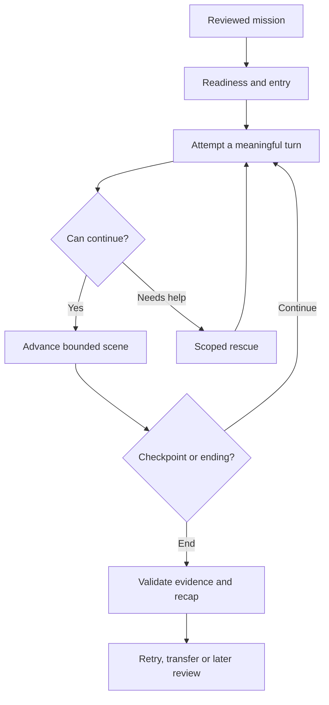

# LearnByRP — Complete Learning, Content, Levels and UX Architecture

**Version:** 2.0 · **Date:** 3 October 2026  
**Status:** proposed integrated product blueprint; not a statement of repository implementation  
**Audience:** product owner, pedagogy/content authors, designers, engineers and pilot evaluators  
**Initial audience assumption:** independent adult learners; a child edition would need a separate design and safeguarding review  
**Delivery:** mobile first, with an equally usable responsive web experience  
**First content slice:** Belgian Dutch for everyday life, Pre-A1/A1 through B1  
**Long-term architecture:** Pre-A1 through C1; goal-driven personal, social and professional programs

## How to use this document

Use this as the integrated product and learning blueprint. Preserve existing canonical evidence and runtime contracts when implementation names differ. Translate each proposed contract into the current repository rather than creating a second parallel engine.

This document consolidates and extends:

- `LEARNBYRP_SPEAKING_FIRST_LIVING_CURRICULUM_ARCHITECTURE_V1.md`.
- `LEARNBYRP_ROLEPLAY_PROGRAM_ARCHITECTURE_V1.md`.
- The accompanying architectural analysis of the swimming-pool model.

The first two documents were read for this comparison. Their proposals are design context, not proof that all capabilities have shipped. This blueprint does not automatically supersede every existing TODO or authorize a code migration. A reconciliation pass should identify implemented, partial and missing capabilities.

**Evidence notation:** [R#] refers to the source register at the end. Research supports individual mechanisms; proposed product policies and numeric targets require calibration. No cited study establishes that LearnByRP itself teaches faster than another product.

## Contents

1. Product promise and engagement definition
2. Learning architecture and scientific boundaries
3. End-to-end learner process
4. Runtime authority and state transitions
5. Evidence, linguistic observations and progression
6. Level and task-demand design
7. Curriculum and content graph
8. Content production, source review and localization
9. Complete Belgian Dutch learning arc
10. Mobile UX and screen contracts
11. Visual direction and accessibility
12. Engagement, return and motivation
13. Adaptive scheduling and recommendation policy
14. Voice, reliability, privacy and graceful degradation
15. Measurement and product validation
16. Delivery phases and acceptance checklist
17. Source register and open decisions

---

## 1. Product promise and engagement definition

### 1.1 The promise

**LearnByRP turns a reason to learn a language into situations where the learner needs to use it, can recover when stuck, and gradually succeeds independently in new contexts.**

The experience is a living curriculum. The learner meets people, discovers information, makes choices and handles consequences. Behind that experience is a reviewed content graph, a bounded scene runtime and a conservative evidence system.

The valuable outcome is not a completed conversation. It is independent capability that survives a different situation and a later day.

### 1.2 What “addicted to LearnByRP” means in this blueprint

The product should be compelling enough that learners want to return. The target is voluntary practice driven by curiosity, enjoyment, relevance and visible progress. Session length and dependency are not success measures.

Build the desire to return through:

- **Purpose:** this practice serves something the learner wants in life.
- **Agency:** the learner can choose the goal, pressure, duration and help.
- **Competence:** small wins are real and connected to observable behavior.
- **Continuity:** familiar people and places make the next scene worth anticipating.
- **Variety:** the communicative job returns in a changed situation.
- **Safety:** rescue is available and mistakes are recoverable.
- **Closure:** a short session ends well; another scene is an invitation.

Autonomy, competence and relatedness are established constructs in self-determination theory. Applying them to these specific product mechanisms is a design inference [R7].

Do not use lost-streak threats, artificial urgency, random paid rewards, shame after absence, unbounded autoplay or claims that an AI character emotionally needs the learner. The character can be memorable without being deceptive about being a simulation.

### 1.3 Product invariants

1. Roleplay is the primary learning environment.
2. Every assessed mission has a meaningful communicative goal.
3. Beginners receive an achievable opening and sufficient input; speaking first does not mean unprepared exposure.
4. Help preserves participation and is recorded accurately.
5. Accessibility accommodations and pedagogical answer assistance are classified separately.
6. Completion, communicative evidence and linguistic development are separate outputs.
7. A failed scene, silence or a disconnection does not automatically create a lapse.
8. Retry and same-family variants cannot create transfer credit.
9. Models propose; validated policies own durable decisions.
10. The learner sees useful next actions, not the internal evidence machinery.
11. Recurring narrative facts cannot establish competence.
12. Learning claims require delayed, independently evaluated outcomes.

## 2. Learning architecture and scientific boundaries

### 2.1 Four operating loops

| Loop | Responsibility | Input | Output | Guardrail |
|---|---|---|---|---|
| Create a reason | Select a reviewed goal and real information, opinion or reasoning gap | Learner goal, content coverage, current frontier | Mission and visible objective | No arbitrary chat topic presented as curriculum |
| Keep participation possible | Offer the least useful intervention that restores forward movement | Learner request, scene state, breakdown cues | Wait, intention cue, phrase stem, model or comprehension support | Log what was revealed; never force prolonged struggle |
| Capture what happened | Attribute learner behavior to actual opportunities and support conditions | Final transcript, provenance, opportunity instances | Validated communicative evidence and separate linguistic observations | Abstain when uncertain; no completion-based credit |
| Choose what follows | Schedule retry, transfer, review, preparation or greater demands | Evidence history, preferences, content availability | Explainable next scene | No invented assessment opportunity or unsupported promotion |

### 2.2 Supporting mechanisms and limits

| Mechanism | Research basis | Product use | Limit |
|---|---|---|---|
| Goal-directed tasks | TBLT synthesis [R1] | Give language a practical purpose | Overall TBLT effects do not establish this engine’s efficacy |
| Producing and revising language | Output hypothesis and empirical tests [R8] | Attempt, notice a gap, receive help, try again | Output alone is insufficient |
| Corrective feedback | Meta-analysis [R3] | Select one high-value improvement and reuse it | Feedback form and timing depend on context |
| Spaced practice | L2 spacing meta-analysis [R4] | Return to capabilities on later days | Exact product intervals need calibration |
| Balanced curriculum | Nation’s Four Strands [R2] | Include input, output, focused learning and familiar-language fluency work | Rough course balance is not a per-session mathematical quota |
| Developmental readiness | Processability Theory [R6] | Prefer plausible next demands, with language-specific review | No universal language-independent grammar ladder |
| Task sequencing | SSARC/task-complexity framework [R5] | Track demand dimensions separately | No universally optimal speed-first progression |
| Motivation | Self-determination theory [R7] | Support choice, meaningful competence and continuity | Narrative retention mechanisms require product testing |
| Action-oriented learning | CEFR Companion Volume [R9] | Use purposeful activities and reviewed descriptors | App evidence is not CEFR certification |

### 2.3 Four Strands in a roleplay-first product

The interface need not have four separate course sections. The learning ecosystem must still support all four functions [R2].

| Strand | LearnByRP activity | Example | Evaluation |
|---|---|---|---|
| Meaning-focused input | Short contextual listening, read/listen to a character message, observe a scene | Understand a pickup location from a message | Comprehension opportunity where assessed |
| Meaning-focused output | Accomplish a task through speech or explicitly typed practice | Ask for another pickup time | Communicative evidence |
| Language-focused learning | Brief explanation, deliberate phrase/word practice, optional pronunciation work | Compare two time expressions needed in the scene | Separate language-practice observations |
| Fluency development | Repeat an achievable task using familiar language with less effort | Make a familiar arrangement more smoothly | Fluency telemetry plus applicable evidence |

Audit balance over multiple sessions and account for the product’s actual scope. Do not classify all output as fluency development. Familiarity is central to that strand. If LearnByRP is used mainly as a speaking supplement, clearly describe the input and broader study it does not replace.

### 2.4 The beginner policy

An absolute beginner can communicate through a useful chunk, a name, a number or a short request. Formulaic production is a legitimate starting point. It is not evidence of productive control over an entire grammatical system.

Provide a readiness bridge when required:

1. Establish meaning using an image, explanation language or short demonstration.
2. Let the learner hear a reviewed phrase and understand its purpose.
3. Start a tiny interactive task with a low-cost first turn.
4. Keep rescue visible.
5. Revisit the function later without showing the answer.

Preparation can be recommended or required by a particular beginner task’s readiness contract. There is no universal rule that all learners must complete a receptive-only course before roleplay.

## 3. End-to-end learner process

### 3.1 First use

| Step | Learner action | Product behavior | Durable result |
|---|---|---|---|
| Choose language | Select target variety and explanation language | Show a small supported catalogue | Preferences |
| Choose purpose | Daily life, work, travel, interview, social or custom | Offer concrete examples; allow skipping detail | Learner goal |
| Choose starting comfort | New, some experience, comfortable or unsure | Set entry support hypothesis | Placement hypothesis only |
| Choose first situation | Accept the recommended scene or change it | Explain the role and goal in two short sentences | Mission choice |
| Prepare if useful | Observe or try directly | Record exact preparation exposure | Support event |
| Start | Choose voice or permitted typed mode | Ask microphone permission only at voice entry | Modality choice |
| Act | Attempt a turn, get help if needed, change the scene | Run the bounded interaction | Attempt record |
| Reflect | Read/listen to a short recap | Show one success, one next improvement and next scene | Feedback reference |
| Save continuity | Optionally create/sign into an account | Preserve history and settings | Account-linked state |

Guest practice is preferred where operationally feasible. If authentication is required, keep it brief and explain why. Notification permission follows a voluntary reminder request, not the first launch.

### 3.2 Returning learner

Open directly on one recommended situation. Display a short reason such as “Try asking for an alternative somewhere new.” Offer a small alternative when the learner has less time or wants lower pressure.

An unfinished live exchange can resume only from a valid checkpoint. Otherwise offer a fresh attempt or a clear summary. Do not claim that a partially lost session was fully assessed.

### 3.3 Within a session



### 3.4 Session modes

| Mode | Job | Duration assumption | Assessment rules |
|---|---|---|---|
| Quick scene | One narrow communicative job | Approximately 2–5 minutes | Opportunity-specific |
| Dive | A coherent chain around one capability | Approximately 8–15 minutes | Each attempt separately validated |
| Recovery | Rebuild a capability after valid difficulty evidence | Learner-controlled short scene | Help recorded; later independence checked |
| Final simulation | Integrate a goal’s capabilities in a less familiar scene | Task-dependent, declared before start | Reviewed rubric; no certificate inference |
| Explore | Enjoy an unassessed conversation or world scene | Learner-controlled | No official skill progress by default |

Durations are product hypotheses, not research prescriptions. Let the learner stop at a checkpoint.

## 4. Runtime authority and state transitions

### 4.1 Component ownership

| Component | May do | May not do |
|---|---|---|
| Program composer | Propose reviewed skill IDs, goals and mission sequences | Invent skills or declare competence |
| Mission compiler | Resolve approved content into an executable definition | Bypass content, capability or safety validation |
| Actor | Speak in character and propose permitted actions | Own world truth, scoring or curriculum |
| Director | Select approved complications, opportunities and pressure changes | Invent assessed challenges during execution |
| Scene reducer | Validate actions and update world state | Infer linguistic ability |
| Coach | Offer bounded help and grounded feedback | Mark support as independent production |
| Voice adapter | Deliver audio, turn events and provenance | Convert provider confidence into learner competence |
| Assessor | Propose interpretations linked to passages | Persist official skill evidence directly |
| Evidence validator | Enforce eligibility, opportunity and provenance rules | Guarantee every semantic judgment is correct |
| Projection engine | Derive frontiers under versioned policies | Erase prior attempts or backfill unrelated bands |
| Next-scene selector | Choose eligible reviewed next activities | Hide missing content by fabricating readiness |

These are logical responsibilities, not a requirement for ten autonomous LLM agents. Begin with deterministic components and a small number of bounded model calls.

### 4.2 Attempt lifecycle

`created → entry_ready → active → checkpointed → ended → assessment_pending → assessed | assessment_incomplete`

Additional explicit terminal/status reasons: `cancelled`, `transport_interrupted`, `audio_unusable`, `content_incompatible`, `assessment_failed`.

Scene outcome and assessment status are separate. A completed scene can remain assessment-incomplete; the learner can still receive an honest activity summary.

### 4.3 Live-turn processing

1. Capture the learner turn with timestamps and attribution.
2. Distinguish partial recognition from final attributable transcript.
3. Record ambiguity or transport problems.
4. Resolve eligible world actions under the current revision.
5. Director selects only currently valid opportunities or complications.
6. Actor receives accepted facts and permitted actions.
7. Deliver the actor response; record playback and interruptions where relevant.
8. Emit opportunity exposure/taken events only under the authored rules.
9. At a checkpoint or ending, propose and validate evidence.
10. Save through the existing validator-authorized persistence boundary.

Do not block every natural conversational turn on a full offline assessment. Live control and durable assessment have separate latency and failure policies.

## 5. Evidence, linguistic observations and progression

### 5.1 Three independent outputs

| Output | Question answered | Example |
|---|---|---|
| Scene outcome | Did the task’s world objective happen? | A replacement bike was arranged |
| Communicative evidence | What did the learner independently accomplish in a valid opportunity? | Requested an alternative in an A2 production opportunity |
| Linguistic observation | Which forms appeared, and how? | A phrase was independently retrieved; a tense error recurred |

“Yesterday I go store” may communicate a past event under a suitable rubric. It does not demonstrate accurate past-tense morphology. Store these interpretations separately.

### 5.2 Communicative evidence key

Preserve the canonical key:

`skill × assessed channel × evidence band × scenario family`

Delivery modality is additional provenance. Spoken and typed performances must remain distinguishable even when both assess production. A mission’s display level does not assign its level to every opportunity.

Required provenance includes attempt, mission/content version, opportunity instance, learner passages, exposure and support events, assessment/validator versions, evidence band, channel and family.

### 5.3 Rescue ladder

| Help | Example | Evidence handling |
|---|---|---|
| Wait/think | Pause the pressure | No answer exposure; retain condition provenance |
| Intention cue | “Ask for another time” | Record task guidance; rubric determines eligibility |
| Stem | “Kan ik…” | Form exposure for affected target |
| Full phrase | “Kan ik morgen terugkomen?” | Affected production cannot be called unassisted |
| Model playback | Hear the full phrase | Same exposure restriction; repetition is practice |
| Meaning/input support | Translate or replay the character turn | Evaluate effect on the assessed comprehension target separately |

Scope support to targets and opportunities where possible. If the system cannot reliably scope exposure, apply the conservative fallback policy. Do not erase all unrelated evidence merely because help was used once.

### 5.4 Accessibility distinction

An accommodation that does not reveal the assessed answer need not invalidate production evidence. However, changing speech rate or showing captions may alter a listening task’s authored conditions. Record the accommodation and determine eligibility against that opportunity’s contract. Avoid the blanket claim that all accessibility features are assessment-neutral in all channels.

### 5.5 Linguistic observation contract

Proposed fields, to be reconciled with existing types:

```text
observationId, attemptId, languageVariety, contentVersion
targetType: lexical_item | construction | pronunciation_feature
targetId, learnerPassageRefs, audioSpanRefs?
status: observed | ambiguous | uninterpretable
formUse: appropriate | potentially_inaccurate | not_judged
supportRefs, assessorVersion, confidenceAndLimitations
context, observedAt
```

Use observable labels rather than “acquired”, “fossilized” or “developmentally mastered”. Cross-session hypotheses require multiple attributable occurrences and explicit policy. Construction definitions and rubrics are language-specific.

### 5.6 Recurring-error loop

1. Detect a candidate pattern in multiple usable passages.
2. Check whether it matters to the current communicative goal and learner readiness.
3. Offer a brief explanation and a reviewed example at a natural checkpoint.
4. Provide a low-pressure retry using that form meaningfully.
5. Schedule another eligible opportunity on a later day or in a new family.
6. Look for independent use; keep uncertainty if evidence is sparse.

Never fabricate incomprehension merely to correct every grammatical error. Design real missing-information or ambiguity challenges; handle other form issues through selective feedback.

### 5.7 Progression policy

Use existing Supported/Growing/Steady or equivalent states under versioned rules. State changes require eligible observations, not a count of completed missions.

Placement chooses a starting hypothesis; it cannot confer durable mastery or transfer qualification. Higher-band observations do not silently backfill lower bands. Transfer requires a reviewed different family, not new names or decorative scenery.

Do not add a Learning Potential Score until its construct, reliability and interpretation are validated. A support history is useful without a psychometric-looking composite number.

## 6. Level and task-demand design

### 6.1 Level means authored demand

CEFR descriptors inform content design [R9]. These examples are proposed mappings, not official descriptor quotations or automatic level certification.

| Band | Typical communicative job | Input/interaction conditions | Appropriate support | Stronger evidence looks like |
|---|---|---|---|---|
| Pre-A1 | Identify self, request a familiar item, give a number | Highly predictable, short turns, visual context | Meaning bridge, model and tiny phrase | Later independently retrieves a useful short contribution |
| A1 | Order, ask a simple question, confirm a basic detail | Familiar topic, clear interlocutor, narrow goal | Optional observe and accessible rescue | Completes a simple exchange without exposed target wording |
| A2 | Arrange, substitute, explain a routine problem | Short follow-ups, one practical complication | Intention prompts; phrase help on request | Handles predictable variation across situations |
| B1 | Explain what happened, give reasons, resolve a practical issue | Several connected turns, natural clear language | Planning and focused feedback | Maintains the explanation and repairs misunderstanding |
| B2 | Negotiate alternatives, defend a position, handle competing constraints | Less predictable turns, richer information | Optional planning and targeted debrief | Adapts argument and register across a sustained exchange |
| C1 | Mediate, manage nuance, resolve ambiguity in a demanding interaction | Implicit meaning, dense information, multiple perspectives | Strategic preparation; nuanced feedback | Controls an extended interaction under reviewed high demands |

### 6.2 Separate demand dimensions

```text
TaskDemandProfile
  familiarity: topic, setting, communicative job
  input: rate, length, lexical load, register, variety
  conceptual: reasoning, time reference, perspective, information relations
  interaction: turn count, interruptions, interlocutors, ambiguity
  procedure: planning time, simultaneous demands, response window
  production: expected discourse length, precision, register requirements
  support: entry support and permitted assistance
  accessibility: declared accommodations and assessment effects
```

Avoid a single unexplained difficulty score. Change one principal demand at a time when testing causality. Do not equate faster speech or rare vocabulary with higher CEFR bands.

### 6.3 Readiness and stretch

Prefer a task where the core communicative job is achievable and one demand is new. The readiness estimate combines demonstrated capability, support history, learner choice and content prerequisites. It is a hypothesis, not a diagnosis.

If pressure causes repeated breakdown, reduce time pressure, shorten input, simplify the goal or offer planning. Pause duration alone cannot establish cognitive overload or anxiety.

### 6.4 Content level review

Two reviews are preferred for assessed releases: pedagogy/descriptor alignment and target-language/locale authenticity. Reviewers inspect the actual opportunity and rubric, not just the mission title. Record disagreements and rationale. Calibrate difficulty with pilot data without pretending the initial band is statistically validated.

## 7. Curriculum and content graph

### 7.1 Graph entities

| Entity | Purpose |
|---|---|
| Goal | Why the learner wants the language |
| Program | Adaptive selection space serving the goal |
| Arc | Narrative continuity across related missions |
| Scenario family | Meaningfully distinct setting and task structure for transfer |
| Mission | Reviewed executable communicative situation |
| Opportunity | A specific chance to demonstrate a capability |
| Rubric | What counts, does not count and remains uncertain |
| Language target | Reviewed lexical item, construction or optional sound feature |
| Input asset | Audio, message, image or short model |
| Support asset | Scoped hint, stem, phrase, meaning or explanation |
| Feedback recipe | Passage-grounded improvement and return-to-use activity |
| Transfer edge | Reviewed connection to a different family |
| Review edge | Later retrieval opportunity |
| Demand variant | A controlled change to task conditions |

### 7.2 Coverage matrix

Maintain a queryable matrix of capability × band × channel × family × language variety × entry mode. Before recommending a transfer or band-up, verify that a compatible reviewed opportunity exists.

A coverage gap is a content backlog item. It must not be repaired at runtime by inventing an assessed scene.

### 7.3 Mission authoring template

```yaml
mission:
  id: nlbe_parcel_change_pickup_a2_v1
  status: draft
  target_variety: nl-BE
  family: parcel_service
  display_band: A2
  role: customer collecting a parcel
  premise: the parcel is not at this counter yet
  visible_goal: find a workable way to collect it
  initial_facts:
    parcel_available_here: false
    alternative_location: nearby collection point
  knowledge_boundaries:
    actor_knows: [available_options, opening_hours]
    learner_knows: [own_availability]
  permitted_actions: [ask_options, confirm_location, arrange_collection]
  complications: [one_option_conflicts_with_learner_availability]
  completion: workable_option_confirmed
  opportunity_ids: [request_alternative_a2, confirm_details_a1]
  support_assets: [intention, stem, phrase, meaning, model]
  entry_modes: [guided, cold]
  transfer_targets: [equipment_rental, neighbour_coordination]
  sources: [reviewed_locale_language_reference]
  review_requirements: [pedagogy, locale, runtime]
```

This is an illustrative authoring format, not a repository schema. Actor improvisation can vary dialogue within approved boundaries, not replace reviewed opportunities.

### 7.4 Opportunity rubric template

- Communicative skill and evidence band.
- Assessed channel and eligible modalities.
- Trigger: what makes the opportunity genuinely available.
- Exposure: how the learner knows enough to act.
- Taken condition: what constitutes an attributable attempt.
- Demonstration criteria and accepted variation.
- Near misses and counterexamples.
- Permitted support and accommodations.
- Uncertainty/abstention cases.
- Valid lapse conditions, if applicable.
- Required provenance and reviewer rationale.

### 7.5 Generation boundaries

Use AI to draft variants, suggest phrasing, propose characters and help authors identify missing branches. Publishing assessed content requires review and compilation gates. Free exploration can be more flexible if it remains clearly unassessed and respects bounded content rules.

## 8. Content production, source review and localization

### 8.1 Production pipeline

`needs analysis → coverage gap → mission draft → language assets → pedagogy review → locale review → runtime compilation → adversarial playtest → learner pilot → release → calibration`

Every release has a version, reviewers, source provenance, asset rights, compatibility requirements and a changelog. Material rubric changes must not silently reinterpret historical evidence.

### 8.2 Content quality gates

| Gate | Required evidence |
|---|---|
| Meaning | Goal makes sense independently of displaying a grammatical form |
| Information | Actor/learner knowledge boundaries create a genuine communicative need |
| Agency | More than one acceptable learner formulation or route where appropriate |
| Level | Actual input, task conditions and opportunity rubric support the proposed band |
| Support | Complete rescue path; exposure can be logged |
| Transfer | Family relationship is reviewed, not a cosmetic reskin |
| Runtime | Actions, endings and complications are valid and bounded |
| Assessment | Positive cases, near misses, support-contaminated cases and abstention cases exist |
| Locale | Target variety and register reviewed by a competent speaker |
| Inclusion | No stereotype-dependent characterization or humiliating learner setup |
| Assets | Rights, consent and attribution established |
| Reliability | Task remains usable through recoverable voice or network errors |

### 8.3 Source hierarchy

1. Primary language-learning research and systematic syntheses for mechanism claims.
2. Council of Europe descriptors for band design.
3. Authoritative language references and qualified locale review for language assets.
4. Official service information for factual local context where used.
5. Learner pilot evidence for actual difficulty and usability.

Marketing articles, rankings and generic search pages cannot establish pedagogical efficacy. Keep a claims ledger with source, scope, confidence, date and product inference. Audit repeated citations that point to an unrelated paper.

### 8.4 Locale policy

Language variety is first-class: `nl-BE` content should use reviewed Belgian Dutch where appropriate, while remaining understandable and pedagogically purposeful. Do not portray all speakers in a locale as using one accent or register.

Separate:

- Interface/explanation language.
- Target language variety.
- Character register and voice.
- Mission cultural context.
- Language-specific construction and lexical targets.

Translation is not a curriculum port. Re-author lexical targets, politeness, word order, pronunciation features and useful task formulations per language. Reuse images only when their meaning fits the localized scenario.

### 8.5 Audio and visual assets

Reference audio needs pronunciation, pacing, register and meaning review. Synthetic reference audio may be used after review; it is not inherently authentic merely because it sounds fluent. Label voice provenance internally. Obtain consent and rights for human recordings.

Assets should clarify the situation: a parcel, timetable, menu, location or object. Do not decorate the live screen with irrelevant detail. Avoid automatically embedding private learner information into generated images or audio.

## 9. Complete Belgian Dutch learning arc

### 9.1 Goal and cast

**Goal:** handle everyday arrangements in Belgian Dutch.  
**Capability:** ask for an alternative and confirm the chosen option.  
**Recurring setting:** a fictional neighbourhood in Brussels.  
**Cast:** café employee Lotte, parcel clerk Amir, bike-rental employee Noor, neighbour Jules. Character names and personal details are fictional content, not assumptions about real users.

### 9.2 Arc progression

| Episode | Situation | Learning job | Demand | Evidence interpretation |
|---|---|---|---|---|
| 1 | Familiar café item unavailable | Try asking for another item | Tiny choice, optional model | Guided practice; exposed forms not cold evidence |
| 2 | Return to the café | Retrieve the request more independently | Familiar job, changed available item | Retry/same-family variation |
| 3 | Parcel pickup time does not work | Ask for a workable alternative | Different family, one constraint | Transfer candidate if eligibility rules hold |
| 4 | Later review at bike rental | Request another option and confirm a detail | Different setting, later day | Delayed independent retrieval |
| 5 | Coordinate with a neighbour | Explain why an arrangement does not work | Connected reason, another perspective | Reviewed B1 stretch when ready |
| 6 | Unfamiliar practical problem | Integrate request, reason and confirmation | Novel assessed scenario | Final outcome task; separate rubric |

The episodes are an authoring skeleton. The adaptive selector may insert preparation, a short review or another family; it must not force everyone through identical dates or imply that six scenes confer B1.

### 9.3 Example interaction and help

Lotte: “Die broodjes zijn op. Wil je iets anders?”  
Learner goal: choose an alternative breakfast item.

Possible rescue assets, pending locale review:

- Intention: “Ask what else is available.”
- Stem: “Wat hebt u…”
- Phrase: “Wat hebt u nog?”
- Model: reviewed audio of the phrase.

Accept multiple appropriate requests. Do not require the learner to reproduce the model exactly. If a phrase is shown or played, the affected performance is assisted.

### 9.4 Recap and later transfer

Recap: “You found another option. The phrase helped you ask what was available. Next time, try asking before opening help.”

Later, a parcel scene creates a new need. The character cannot know the learner’s availability until it is communicated. The scene advances after an acceptable arrangement; the assessment separately checks the authored alternative-request opportunity.

### 9.5 A repeated form issue

If multiple reliable passages suggest difficulty describing future availability, offer a short useful pattern with meaning and two reviewed examples. Then return to arranging a real time. Later independent retrieval is evidence; reading the example back is practice.

## 10. Mobile UX and screen contracts

### 10.1 Information architecture

Keep the established **Talk / Missions / Progress** navigation. Put account, language, accessibility and reminder settings behind a predictable profile/settings entry. A program belongs inside Missions and can also be accessed from Talk’s next-scene card.

Do not add separate primary tabs for grammar, vocabulary, characters, badges, history and planning. Attach support to the scenes and expose deeper resources progressively.

### 10.2 Screen specifications

| Screen | Primary job | Required content | Main action | Secondary actions |
|---|---|---|---|---|
| Language entry | Choose how to learn | Target variety, explanation language, supported availability | Choose language | Accessibility |
| Goal entry | Make practice relevant | Goal presets, optional plain-language goal | Build my first situation | Skip detail |
| Talk | Start useful practice | One next scene, short reason, duration estimate | Start/Continue | Shorter scene, change situation |
| Missions | Explore eligible practice | Current program, reviewed families, accessible filters | Open mission | Program goal/settings |
| Program | Understand the path | Goal, current episode, upcoming purposes | Continue | Change goal, inspect other scenes |
| Briefing | Understand role and task | Where, what happened, your goal | Enter scene | Observe, prepare, accessibility |
| Live roleplay | Take meaningful turns | Character/context, goal, turn state, input control, rescue | Speak or send | Pause, end, transcript settings |
| Rescue sheet | Recover with minimal friction | Next help rung; listen/meaning actions | Use this help | More help, close |
| Checkpoint | Apply one useful improvement | One grounded item, optional micro-explanation | Try again | Continue scene |
| Recap | Understand the result | Outcome, evidence summary, help attribution, one improvement | Recommended next action | Retry, stop |
| Progress | See practical capability | Plain-language skill rows and attributable examples | Practice a capability | Evidence detail/history |
| Settings | Control the experience | Language, privacy, voice, accessibility, reminders | Save preference | Export/delete history |

### 10.3 Talk screen hierarchy

1. Short personal goal context.
2. One visually dominant scene card with a situation image, useful title and goal.
3. A clear Start/Continue button visible on a small phone.
4. One short recommendation reason.
5. Optional Dive or alternate scene below.

First-use copy: “Your first situation is ready.” Returning copy should reference the communicative job, not guilt or vague motivation.

### 10.4 Program UX

Show a route through scenes rather than a spreadsheet of tasks. Expand the next scene; collapse future scenes. Explain why something is unavailable, but allow previewing future content. Do not lock unrelated exploration solely to manufacture retention.

The route can change after real evidence. Communicate this simply: “A new situation will help you practise this independently.” Preserve completed attempts in history; adaptation does not rewrite the past.

### 10.5 Live-screen states

| State | Visible message/control | Runtime implication |
|---|---|---|
| Ready | “Your turn” with input affordance | Capture may begin |
| Listening | Clear capture indicator and stop | Learner controls recording |
| Processing | Brief progress state; cancellation available | No duplicate turn submission |
| Character speaking | Playback state, interrupt/pause | Track interrupted audio when relevant |
| Stuck | Rescue remains reachable | No punishment or failure inference |
| Connection lost | “Connection paused. Try again or switch mode.” | No competence judgment |
| Uncertain recognition | “I may have heard that incorrectly.” | Verify or retry; abstain where needed |
| Ending | Natural scene close and explicit exit | Scene outcome recorded separately |
| Assessment pending | “Your scene is saved. Feedback is still processing.” | Do not invent progress |

Avoid waveform-only communication. Captions, readable state labels and input controls remain available according to task policy.

### 10.6 Recap rules

Display:

- What happened in the scene.
- What the learner did independently, if valid evidence exists.
- Where help supported participation.
- One actionable improvement.
- One recommended next action and an easy stopping action.

No universal numeric score. No “You are now B1”. When no valid target evidence exists, say what was practised without manufacturing achievement.

### 10.7 Progress rules

Show “Ask for alternatives” or “Explain a practical problem”, then a concise state and example. Details can reveal assessed band, family, date and support conditions. Use “practised”, “demonstrated independently” and “review due” precisely.

Speaking minutes, completed scenes and narrative milestones can be shown as activity history. They must be visually distinct from learning evidence.

## 11. Visual direction and accessibility

### 11.1 Reference basis and lock

Live Refero research was attempted but unavailable because the service reported no active subscription. No external design examples are claimed to have been inspected. This proposal uses the existing LearnByRP architecture, user requirements, Refero’s bundled craft guidance and WCAG [R10]. A later visual pass should compare actual rendered screens with the current project’s canonical design system and user-provided prototype.

**Direction:** an approachable illustrated world with a clear, practical speaking interface. The world gives context; the controls remain calm and legible.

Preserve:

- Scene imagery as orientation, not decorative wallpaper.
- One strong primary action on entry screens.
- Live conversation as the visual focus.
- Short, plain copy and progressive disclosure.
- Compact mobile entry so the first action is visible.

Do not introduce a new competing design system where V4 tokens already exist. The following are provisional roles and sizing commitments, not a claim that existing tokens have been audited.

| Role | Proposal | Rationale |
|---|---|---|
| Base surfaces | Neutral readable background and restrained layers | Keep attention on scene and speech |
| Primary accent | Existing LearnByRP CTA accent | Consistency; one clear action |
| Scene colors | Family-specific illustration palette | Recall and orientation without encoding ability |
| Status colors | Distinct success, caution, error roles with labels/icons | Never rely on color alone |
| Body type | Readable sans serif, approximately 16–18 logical units | Mobile reading and localization |
| Control targets | Aim for at least 44–48 logical units for core mobile actions | Usability target; not a statement of WCAG minimum |
| Motion | Brief state transitions; reduced-motion equivalent | Clarify state without delaying practice |

### 11.2 Responsive requirements

- Test at 320 logical pixels wide, ordinary phone sizes, large phones and tablets.
- Use usable height and font scale, not width alone.
- Respect safe areas, virtual keyboard and bottom navigation.
- Make primary content scroll instead of shrinking text to fit.
- On tablet/web, use extra space for context or optional transcript, not giant mobile cards.
- Live controls remain reachable with captions and large text enabled.
- Localized strings may wrap without hiding actions.
- Avoid horizontal scrolling for ordinary screens.

### 11.3 Accessibility and interaction

Follow WCAG 2.2 for web [R10], with native platform accessibility verification for mobile. Normal web text should meet applicable 4.5:1 contrast requirements, with relevant large-text exceptions. Core controls should exceed minimum targets where possible; WCAG 2.2’s AA target-size criterion has a 24 CSS pixel baseline and exceptions, not a universal 44 pixel requirement.

Provide screen-reader names, predictable focus, keyboard operation, captions/text alternatives, reduced motion and visible asynchronous status. Never disable text scaling or zoom. Do not autoplay microphone capture. Restore focus after sheets. Distinguish pedagogical “slower input” from an accessibility preference and preserve assessed-condition provenance.

## 12. Engagement, return and motivation

### 12.1 The return loop

**Relevant purpose → immediate action → manageable uncertainty → supported success → honest improvement → a desirable next situation → later independent retrieval.**

This is a product hypothesis built around motivation constructs [R7] and learning mechanisms. It must be evaluated against actual transfer, voluntary return and learner satisfaction.

### 12.2 Engagement mechanisms

| Mechanism | Learner experience | Learning purpose | Boundary |
|---|---|---|---|
| Recurring cast | Recognize familiar fictional people | Reduce orientation burden and build continuity | No claims of emotional need or real friendship |
| Practical cliffhanger | Know the next situation’s premise | Encourage a planned return | Each scene still has a satisfying stopping point |
| Choice with consequences | Select a route, time or solution | Create genuine reason to communicate | Consequences remain bounded and recoverable |
| Visible independence | Compare assisted practice with later independent use | Make progress credible | No manipulated score inflation |
| Personal relevance | Practise an upcoming real-life task | Increase value of effort | Sensitive detail optional and minimized |
| Small wins | A brief attainable opening | Encourage participation | Win reflects real behavior, not generic praise |
| Variety around a capability | A familiar function in another setting | Support transfer | Cosmetic reskins do not count as transfer |
| Flexible rhythm | Choose short or longer practice | Make return feasible | No punishment for missed days |
| Review with purpose | A known capability comes back in a scene | Retrieval after time | No arbitrary badge grind |

### 12.3 First meaningful reward

The earliest reward is causing something to happen through language: receiving a useful answer, arranging a time, choosing an item or repairing confusion. A small animation or character reaction can acknowledge the event. Evidence credit follows its own rules.

### 12.4 Habit design

Let the learner choose a practical weekly rhythm and optional cue, such as after breakfast or before commuting. Offer a short scene when time is limited. Reminder timing and quiet hours are user controlled; provide easy opt-out and cap frequency.

Example reminder: “Want a short Dutch scene today? Practise changing an arrangement.”

After absence: “Welcome back. Start with a familiar situation or try something new.” Do not assume a lapse because the learner was absent.

### 12.5 Narrative design

Use small arcs of approximately 3–6 scenes as an initial content design hypothesis. Each arc has a purpose, recurring context, one or more capabilities and a satisfying resolution. The story reacts to decisions but cannot override pedagogical eligibility.

The fictional world can remember a selected item, arrangement or permitted alias. Avoid unnecessary memory of sensitive health, employment or family disclosures. Let the learner reset narrative continuity independently of evidence history where feasible.

### 12.6 Rewards and business model

Separate narrative/activity rewards from competence. Optional collectibles can represent visited places, not certified language ability. Exclude competitive ranking by raw speaking time.

Keep rescue, accessibility, honest results and stopping controls available during an active scene. Present subscription limits clearly before starting unavailable content. If the paid offer includes more programs or advanced simulations, explain that value without interrupting a learner’s recovery with a payment gate.

### 12.7 Engagement evaluation

Compare voluntary return, completed useful sessions, independent transfer and satisfaction. A feature that raises minutes but reduces learning, autonomy or satisfaction should not be considered successful. Do not claim that a particular animation, streak or character scientifically guarantees habit formation.

## 13. Adaptive scheduling and recommendation policy

### 13.1 Selection inputs

Use current skill frontiers, eligible review due state, scenario-family history, support exposure, learner goal, preferred duration/pressure, content coverage, modality and capability compatibility.

### 13.2 Decision sequence

1. Apply safety, language, review-status and transport compatibility filters.
2. Check whether the learner chose an explicit eligible scene.
3. If entry readiness is insufficient, offer a preparation bridge or smaller task.
4. If a capability has valid recovery needs, offer bounded recovery.
5. If review is due, offer a suitable retrieval scene.
6. If recent learning is supported, offer another attempt before treating it as independent.
7. If independent evidence needs broader context, prefer a different reviewed family.
8. If the current frontier and learner choice support stretch, increase one principal demand.
9. If no eligible assessed content exists, state the limitation and offer known practice or clearly unassessed exploration.

Priority conflicts must be resolved by a versioned policy and visible explanation, not arbitrary LLM choice. Avoid overloading every return session with remedial work; relevance, preference and content variety matter.

### 13.3 Spacing

Use configurable initial intervals, not a claimed optimal fixed sequence. Spacing research supports later retrieval [R4]; the exact interval depends on target, performance and retention objective. Pilot schedules can compare short and longer returns. Same-day retry serves a different purpose from delayed retention.

### 13.4 Explanation contract

Every recommendation has a reason code and human sentence. Examples: “Try this in a new setting”, “Practise the phrase without the model”, “Return to an arrangement you practised earlier”, “Add one complication when you feel ready.”

Store candidate exclusions and policy version for debugging. Learners do not need to see the candidate scoring machinery.

## 14. Voice, reliability, privacy and graceful degradation

### 14.1 Provider-independent architecture

Use adapters for supported live voice or ASR/LLM/TTS paths. Check actual provider capabilities before proposing challenges requiring interruption, precise audio spans, multiple speakers or reliable timing. Do not hardcode assumptions about current model or SDK versions; verify official documentation during implementation.

Standard ASR does not automatically supply validated phoneme accuracy, pitch interpretation or pronunciation assessment. Such features require suitable audio analysis, rubrics and evaluation. Keep them out of the initial learning authority unless validated.

### 14.2 Error policy

| Failure | UX response | Evidence consequence |
|---|---|---|
| Permission denied | Explain voice requirement; offer compatible mode | Typed performance remains explicitly typed |
| Noisy/unclear audio | Offer retry or confirmation | Abstain on affected targets |
| Interrupted playback | Replay or continue | Preserve exposure/condition uncertainty |
| Network drop | Pause, reconnect, recover checkpoint | No automatic lapse |
| Model timeout | Retry safely or end with saved activity | No invented result |
| Assessment failure | Honest pending/incomplete recap | No unvalidated persistence |
| Duplicate event | Idempotent handling | One durable attempt/event effect |
| Unsupported content capability | Select compatible mission | Do not silently weaken challenge rules |

### 14.3 Reliability targets

Instrument end-to-end latency, interruption handling, mission-start success, checkpoint recovery and assessment completion. Select service targets after a device/network baseline. Any numeric target is an engineering objective, not a contractual SLA until explicitly adopted and operationally supported.

A key release invariant is zero successful unvalidated evidence writes in verification cases. This protects persistence authority but does not establish zero semantic assessment errors.

### 14.4 Privacy model

Minimize raw audio retention; define explicit user controls and retention periods before launch. Separate identifiable profile, permitted narrative facts, attempt records and derived evidence. Provide deletion/export behavior and explain what is retained. Store only facts needed for the learner’s chosen goal and continuity.

Do not infer mental state or anxiety from voice as authoritative truth. Use optional self-report for difficulty and comfort. Avoid encouraging real sensitive disclosures to make fictional scenarios more immersive.

## 15. Measurement and product validation

### 15.1 Metric separation

| Category | Examples | Interpretation |
|---|---|---|
| Activation | Time to first meaningful speech, abandonment before first turn | Entry usability |
| Activity | Speaking time, turns, scenes completed | Participation; not competence |
| Support | Rescue level, exposure targets, later independent use | Assistance trajectory |
| Communicative learning | Eligible independent observations, cross-family and cross-day performance | Governed in-app evidence |
| Linguistic development | Reviewed form-use observations, independently assessed accuracy | Separate language outcomes |
| Experience | Optional difficulty report, satisfaction, willingness to return | Learner perspective |
| Reliability | Latency, ASR problems, recovery, assessment abstention | System quality |
| External outcomes | Unseen task performance and delayed retention | Product efficacy |

### 15.2 Main trial

Compare LearnByRP with high-quality generic AI roleplay using matched practice time, target language, approximate starting ability, frequency and comparable voice quality. Choose a primary endpoint before running the trial.

Recommended primary endpoint: performance on unfamiliar communicative tasks, scored by independent raters unaware of condition where feasible. Include delayed testing. Measure accuracy and interaction as well as fluency; faster speech alone can hide deteriorating precision.

Pre-register allocation, rubric, sample-size rationale, missing-data handling, exclusions and analysis. Pilot usability first; a small usability pilot cannot substantiate a population-level efficacy claim.

### 15.3 Evaluator calibration

Build a reviewed dataset containing independent success, assisted success, near misses, no opportunity, non-attempt, noise, interruptions, ambiguous attribution and varied acceptable language. Measure agreement with human judgments and false-credit/false-lapse rates by relevant language, band and modality. Investigate accent-related and recognition-related errors.

Deterministic validation constrains eligibility. It does not replace semantic calibration of assessor proposals.

### 15.4 Claims policy

Allowed before outcome validation: factual descriptions of the experience, such as goal-driven roleplay, recorded support and reviewed transfer tasks.

Require comparative evidence before claiming faster learning, higher retention, reduced anxiety or superior outcomes. Do not borrow the d = 0.93 TBLT result as LearnByRP’s effect size [R1].

## 16. Delivery phases and acceptance checklist

### 16.1 Build order

| Phase | Deliverables | Exit condition |
|---|---|---|
| 0 — Reconcile | Map this proposal to canonical contracts and existing TODOs | No competing evidence/runtime architecture |
| 1 — Truth and content slice | Validator-only writes, scoped support, reviewed opportunities, compatible voice path | Assisted/noisy/no-opportunity cases cannot create independent credit |
| 2 — Speaking UX | Compact entry, beginner bridge, live rescue, pending/error states, concise recap | Learner can attempt and recover on a small phone |
| 3 — Full learning loop | Retry, different-family transfer, later return, explainable recommendations | End-to-end supported → independent → transfer path works |
| 4 — Linguistic development | Separate observations, reviewed targets, recurring-error micro-intervention | Form feedback never overwrites communicative evidence |
| 5 — Living program | Recurring cast, arcs, permitted continuity, optional reminders | Continuity feels coherent and stopping remains easy |
| 6 — Calibration | Usability pilot, assessor agreement checks, content demand calibration | Major failure patterns corrected before broader rollout |
| 7 — Expand | Deeper B1, later B2/C1 and additional reviewed locales | Review capacity and outcome evidence justify scope |

### 16.2 Initial slice scope

Choose a small set of capabilities with genuinely different families and all required support assets. Prioritize asking for information, requesting alternatives, confirming details, arranging a time, explaining a practical problem and clarification/repair.

The exact mission count should follow coverage requirements and authoring capacity. A nominal library of 100 shallow scenes is less useful than a smaller complete graph with reliable retry, transfer and review opportunities.

### 16.3 Product acceptance

- [ ] New learner understands the role and goal without a long tutorial.
- [ ] Absolute beginner receives a meaningful, achievable opening.
- [ ] Core Start, input and rescue controls work on small screens and large text.
- [ ] Learner can complete an assisted scene without shame or lost progress.
- [ ] Showing or playing the target form cannot create unassisted target evidence.
- [ ] Completion can produce zero target-skill evidence.
- [ ] Failure, silence and disconnection can produce zero lapse.
- [ ] Typed and spoken performances remain distinguishable.
- [ ] Accommodation effects are interpreted against the assessed channel and task contract.
- [ ] A mission can contain opportunities at different authored bands.
- [ ] Same-family replay cannot qualify as transfer.
- [ ] Later retrieval is scheduled without equating absence with forgetting.
- [ ] Communicative success does not imply grammatical accuracy.
- [ ] Linguistic observations retain uncertainty and passage provenance.
- [ ] Actor cannot invent authoritative world state or competence.
- [ ] Assessor uncertainty produces abstention rather than fabricated progress.
- [ ] Recommendation points to compatible reviewed content and has a clear reason.
- [ ] Recap is honest when assessment is pending or incomplete.
- [ ] Narrative memory is governed separately from evidence.
- [ ] Notifications are optional, controllable and non-punitive.
- [ ] Each session offers a satisfying stopping point.
- [ ] The product can be compared with generic AI roleplay on novel delayed tasks.

## 17. Source register and open decisions

### 17.1 Verified mechanism and framework sources

**[R1] Bryfonski, L. & McKay, T. H. (2019). TBLT implementation and evaluation: A meta-analysis.**  
Language Teaching Research, 23(5), 603–632. The synthesis reports 52 studies and an overall strong positive effect across varied outcomes. It is not a LearnByRP trial or a fluency-only estimate.  
https://journals.sagepub.com/doi/10.1177/1362168817744389

**[R2] Nation, P. (2007). The Four Strands.**  
Innovation in Language Learning and Teaching, 1(1), 2–13. Curriculum framework for meaning-focused input/output, language-focused learning and fluency development.  
https://openaccess.wgtn.ac.nz/articles/journal_contribution/The_four_strands/12552167  
https://doi.org/10.2167/illt039.0

**[R3] Li, S. (2010). The Effectiveness of Corrective Feedback in SLA: A Meta-Analysis.**  
Language Learning, 60(2), 309–365. Supports beneficial average effects of corrective feedback with contextual variation.  
https://onlinelibrary.wiley.com/doi/10.1111/j.1467-9922.2010.00561.x

**[R4] Kim, S. K. & Webb, S. (2022). The Effects of Spaced Practice on Second Language Learning: A Meta-Analysis.**  
Language Learning, 72(1), 269–319. Supports spaced learning and retention; does not dictate a single product schedule.  
https://doi.org/10.1111/lang.12479

**[R5] Robinson, P. The Cognition Hypothesis, the Triadic Componential Framework and the SSARC Model.**  
Chapter in The Cambridge Handbook of Task-Based Language Teaching. Basis for making task-demand dimensions explicit; a theoretical design framework rather than proof of one app sequencing policy.  
https://www.cambridge.org/core/books/cambridge-handbook-of-taskbased-language-teaching/cognition-hypothesis-the-triadic-componential-framework-and-the-ssarc-model/053ED33294C6DCFFD9AFDE6E663BD383

**[R6] Pienemann, M. (2015). An Outline of Processability Theory and Its Relationship to Other Approaches to SLA.**  
Language Learning, 65, 123–151. Developmental processing framework; apply with language-specific review and distinguish production from comprehension.  
https://doi.org/10.1111/lang.12095  
Related production/comprehension research: https://www.cambridge.org/core/journals/studies-in-second-language-acquisition/article/abs/production-and-comprehension-in-processability-theory/3EB737693BE76563BD9EC071DBAEA65D

**[R7] Ryan, R. M. & Deci, E. L. (2000). Self-Determination Theory and the Facilitation of Intrinsic Motivation, Social Development, and Well-Being.**  
American Psychologist, 55(1), 68–78. Motivation framework involving autonomy, competence and relatedness; not evidence for a specific app’s retention mechanics.  
https://selfdeterminationtheory.org/SDT/documents/2000_RyanDeci_SDT.pdf

**[R8] Output hypothesis and empirical testing.**  
Foundational reference: Swain, M. (1995), Three functions of output in second language learning, as cited in the companion architecture. Empirical primary study for follow-up: Izumi, S., Bigelow, M., Fujiwara, M. & Fearnow, S. (1999), Testing the Output Hypothesis: Effects of Output on Noticing and Second Language Acquisition. The companion document supplied this reference; its full study was not independently re-read for this deliverable.  
https://www.cambridge.org/core/journals/studies-in-second-language-acquisition/article/testing-the-output-hypothesis/8437C53035A5FD15BD985463E5428B36

**[R9] Council of Europe. CEFR Companion Volume (2020) and descriptor resources.**  
Primary framework for action-oriented learning and illustrative descriptors, including Pre-A1.  
https://www.coe.int/en/web/common-european-framework-reference-languages/cefr-descriptors  
https://www.coe.int/en/web/common-european-framework-reference-languages/cefr-in-the-classroom  
https://book.coe.int/en/education-and-modern-languages/8150-common-european-framework-of-reference-for-languages-learning-teaching-assessment-companion-volume.html

**[R10] W3C. Web Content Accessibility Guidelines 2.2.**  
Primary accessibility standard and target-size interpretation. Native mobile accessibility also needs platform testing.  
https://www.w3.org/TR/WCAG22/  
https://www.w3.org/WAI/WCAG22/Understanding/target-size-minimum

**[R11] Aljaafreh, A. & Lantolf, J. P. (1994). Negative Feedback as Regulation and Second Language Learning in the Zone of Proximal Development.**  
Conceptual reference for contingent graduated mediation. The product rescue ladder is an adaptation, not a reproduction of a validated live-voice app intervention.  
https://doi.org/10.1111/j.1540-4781.1994.tb02064.x

### 17.2 Research integrity notes

- Do not reuse unrelated Four Strands citations as support for every SLA claim.
- The supplied analysis’s 2025 review of 64 studies remains unverified without an identifiable publication.
- A generic conference papers page is not traceable evidence for AI tutoring claims.
- A theory’s plausibility is different from a validated assessment instrument or a proven product outcome.
- References were checked through accessible publisher/institutional records where available; full papers were not all read. Explicitly noted companion references require deeper review before precise empirical claims.

### 17.3 Design decision ledger

| Decision | Basis | Status |
|---|---|---|
| Talk / Missions / Progress | Existing project architecture | Preserve unless explicitly redesigned |
| Compact mission entry and rescue | Existing living-curriculum blueprint; mobile requirement | Proposed screen contract |
| Separate evidence and form observations | Comparison with supplied analysis; evidence integrity | New architecture proposal |
| Beginner preparation bridge | Readiness concern; supported-entry design | Needs content pilot |
| Distinct demand dimensions | SSARC framework and authored difficulty policy | Needs rubric and calibration |
| Voluntary return loop | Self-determination theory plus product inference | Needs engagement/outcome tests |
| Screen accessibility | W3C and bundled design craft | Verify in rendered implementation |
| Visual style | Existing design authority and this provisional direction | Requires prototype/token reconciliation |

### 17.4 Decisions to settle before implementation

1. Map proposed types and states to the current repository’s canonical contracts.
2. Confirm the initial learner segment and paid/free content boundaries.
3. Select qualified locale and pedagogy reviewers.
4. Define raw audio retention and account/guest persistence behavior.
5. Confirm actual voice-provider capability coverage and cost limits.
6. Choose the first fully covered capabilities and scenario families.
7. Finalize visual tokens against the existing design system and prototype.
8. Select the pilot outcome rubric and independent evaluation method.

**Product decision rule:** build the smallest complete loop in which a learner tries, receives honest help, improves, returns later and independently succeeds somewhere new. Make that loop enjoyable enough to repeat. Expand the world only as fast as content quality and evidence reliability allow.
